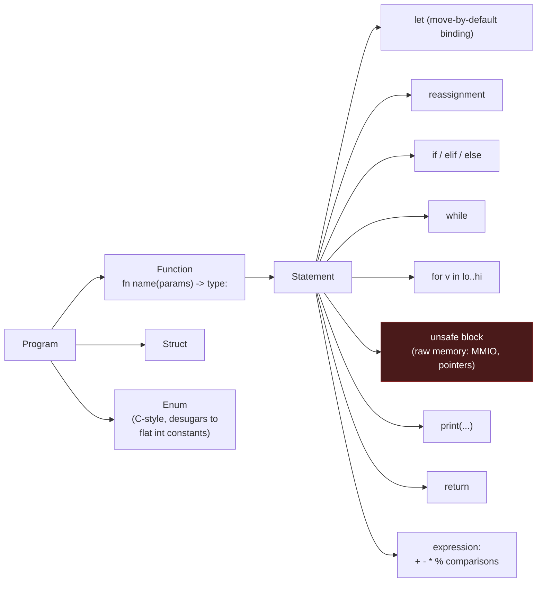
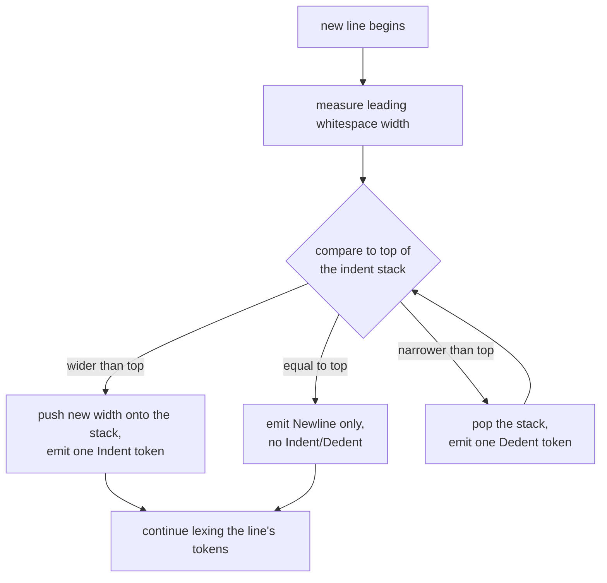
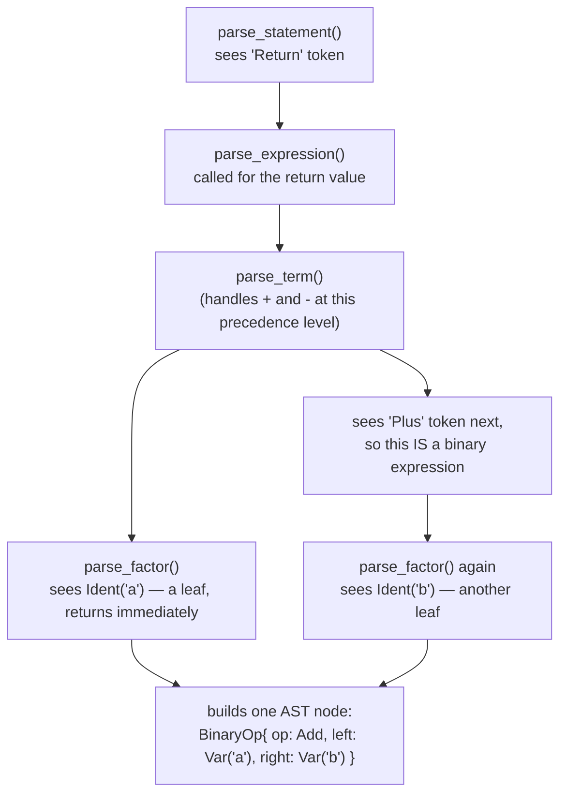
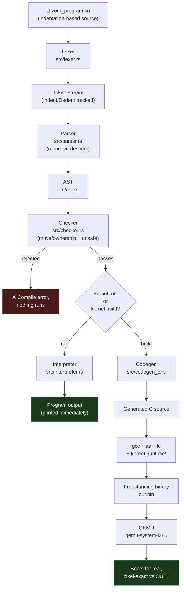
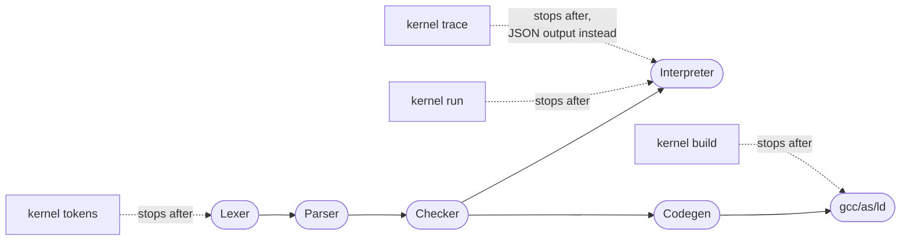
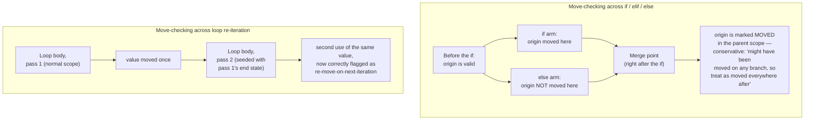
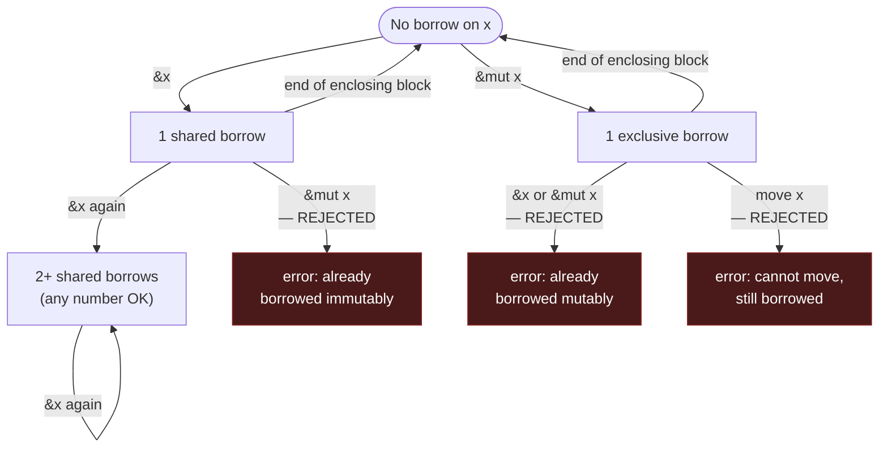
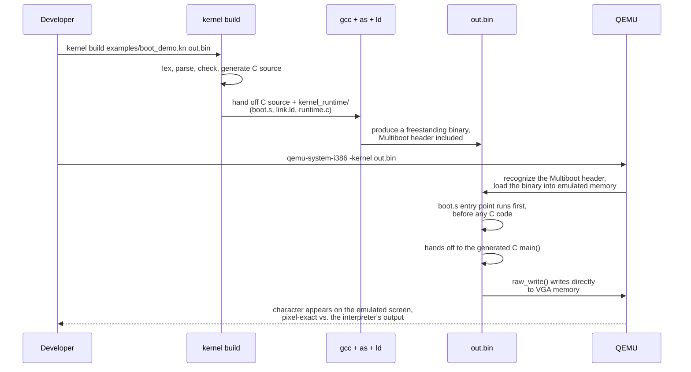
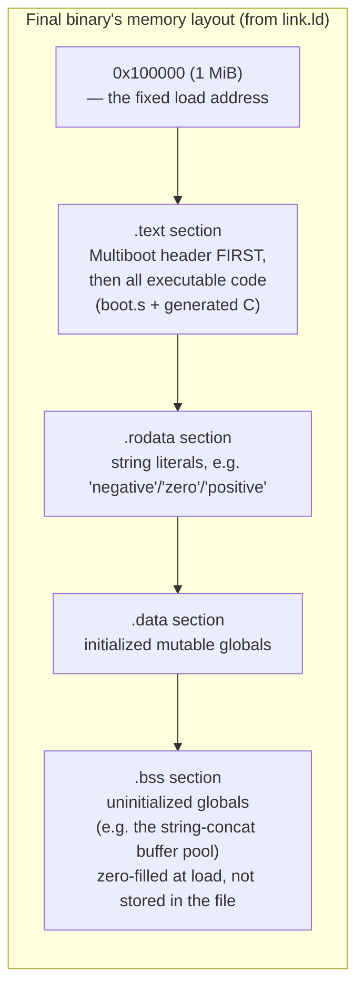
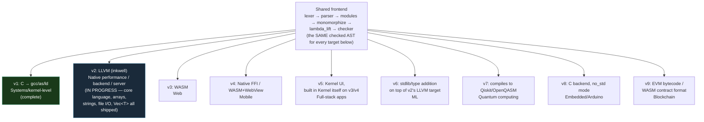

# Kernel (.kn) — Complete Technical Guide

**A memory-safe systems programming language, built from scratch, that reads like Python and compiles to a real bootable binary.**

This document explains everything about Kernel: what it is, why it exists, every technical term involved, how the compiler actually works end to end, and what's real and verified versus what's planned. Written so both a non-technical reader and an engineer can follow it completely.

---

## Table of Contents

1. [The 30-Second Version](#1-the-30-second-version)
2. [Why Kernel Exists](#2-why-kernel-exists)
3. [Glossary — Every Term Used, Defined](#3-glossary--every-term-used-defined)
4. [What Kernel's Syntax Looks Like](#4-what-kernels-syntax-looks-like)
5. [The Compiler Pipeline, Stage by Stage](#5-the-compiler-pipeline-stage-by-stage)
6. [The Ownership Model — Memory Safety Without Rust's Tax](#6-the-ownership-model--memory-safety-without-rusts-tax)
7. [Compiling to a Real Bootable Binary](#7-compiling-to-a-real-bootable-binary)
8. [What's Implemented vs. What's Deliberately Deferred (v1 Scope)](#8-whats-implemented-vs-whats-deliberately-deferred-v1-scope)
9. [The Full Tech Stack](#9-the-full-tech-stack)
10. [Real Bugs Found and Fixed (Engineering Evidence, Not Claims)](#10-real-bugs-found-and-fixed-engineering-evidence-not-claims)
11. [How This Compares to Rust, Python, Go, C, and Zig](#11-how-this-compares-to-rust-python-go-c-and-zig)
12. [The Long-Term Roadmap](#12-the-long-term-roadmap)
13. [Where Everything Lives (Repo Map)](#13-where-everything-lives-repo-map)
14. [Honest Limitations](#14-honest-limitations)
15. [Research References and Official Documentation](#15-research-references-and-official-documentation)

---

## 1. The 30-Second Version

Kernel is a programming language, built entirely from scratch (compiler and all), designed around one pitch: **write systems-level code — the kind you'd normally reach for C or Rust for — in a language that reads like Python.**

What's actually real and working today:
1. You write a `.kn` file in clean, indentation-based syntax (no braces, no semicolons)
2. A compiler — written in Rust, 83,833 characters of source across 7 files — turns it into either:
   - a fast interactive run via a built-in **interpreter** (for development), or
   - a real compiled **binary** that boots and runs on actual hardware-equivalent emulation (QEMU), with output that matches the interpreter exactly
3. Memory safety (the thing that normally requires Rust's famously difficult borrow checker) is enforced automatically at compile time, catching real bugs like "using a value after it's been given away" — without you ever writing a lifetime annotation

This isn't a toy syntax exercise — a real program written in Kernel has been compiled down to a freestanding x86 binary and verifiably booted in an emulator, producing pixel-exact correct output including a raw hardware memory write landing on the exact byte address it was told to.

---

## 2. Why Kernel Exists

Three real, separate problems motivate Kernel's design, each backed by actual research into how developers describe these languages' pain points (not assumption):

- **Python** is pleasant to write but isn't memory-safe and has no realistic story for compiling to a single freestanding binary — native extensions need per-platform builds, and packaging is widely cited as fragmented (pip/conda/poetry/venv all solving the same problem differently).
- **Rust** gives real memory safety but at a documented cost: the 2025 State of Rust Survey cites slow incremental compilation as the single biggest recurring developer complaint, and 22% of non-users cite the borrow checker's learning curve as the reason they haven't adopted it.
- **C/C++** are still the default for "actually write a kernel/bootloader," but offer no compile-time memory safety at all — exactly the class of bug (use-after-free, dangling pointers) that causes the majority of real-world security vulnerabilities in systems software.

Kernel's bet: Python's *readability* plus a *simplified* ownership model (move-by-default, explicit `&` borrows, no lifetime annotations to write) gets most of Rust's safety guarantee without most of its cognitive tax — accepting a real, named trade-off (see [Section 6](#6-the-ownership-model--memory-safety-without-rusts-tax)) rather than claiming to be a complete replacement.

There's also a second, concrete reason Kernel exists: it's the training-data generator for a separate from-scratch LLM project (Kernel-LLM/Whitekernel) — every `.kn` program, run through Kernel's own interpreter, produces a real (source code, actual output) pair used as training data teaching that model real programming semantics, not descriptions of them.

---

## 3. Glossary — Every Term Used, Defined

### Language/compiler fundamentals

| Term | Plain-language definition | Why it matters here |
|---|---|---|
| **Compiler** | A program that reads source code in one language and translates it into another form — here, either executable instructions a computer can run directly, or an intermediate language (C) that a further tool compiles. | What Kernel's `kernel` binary actually is. |
| **Interpreter** | A program that reads source code and executes it directly, statement by statement, without producing a separate compiled file first. | Kernel's `kernel run` command — fast to iterate with while developing. |
| **Lexer (tokenizer)** | The first compiler stage: reads raw text character by character and groups it into meaningful chunks ("tokens") — like recognizing `fn`, `add`, `(`, `a`, `:`, `int` as distinct pieces rather than one blob of characters. | `src/lexer.rs` — the very first thing that touches your `.kn` file. |
| **Parser** | The second stage: takes the lexer's token stream and organizes it into a tree structure (see AST) that reflects the code's actual grammatical structure — which statements are inside which function, which expression is the condition of which `if`. | `src/parser.rs`. |
| **Recursive descent parsing** | A specific, very common parsing technique where the parser is built as a set of functions that call each other recursively, each function responsible for recognizing one grammatical construct (e.g., a function for parsing "a statement," which calls a function for parsing "an expression," which may call itself for nested expressions). | The technique `src/parser.rs` uses. |
| **AST (Abstract Syntax Tree)** | A tree-shaped data structure representing a program's structure after parsing — e.g., a `+` node with two child nodes for the two things being added. | `src/ast.rs` defines Kernel's AST node types; everything downstream (checker, interpreter, codegen) operates on this tree, not on raw text. |
| **Semantic checker (type/safety checker)** | A compiler stage that walks the AST looking for *meaningful* errors the parser can't catch — not "this isn't valid grammar," but "this is grammatically valid and still wrong" (e.g., using a variable after it's been moved away). | `src/checker.rs` — this is where Kernel's memory-safety guarantee is actually enforced. |
| **Code generation (codegen)** | The compiler stage that converts a checked AST into the final output format — in Kernel's case, C source code. | `src/codegen_c.rs`. |
| **Grammar** | The formal set of rules describing what counts as validly structured code in a language (e.g., "a function is the keyword `fn`, then a name, then parentheses with parameters, then `:`, then indented statements"). | Specified in `engineering/RFCs/RFC-002-grammar-specification.md`. |
| **Indentation-based syntax** | A syntax style (Python's signature trait) where the *amount of whitespace* at the start of a line is itself meaningful — it determines which block of code a statement belongs to — instead of explicit braces `{ }`. | Kernel's lexer tracks indentation changes as real tokens (`Indent`/`Dedent`), exactly like Python's own lexer does. |

### Memory safety / ownership terms

| Term | Plain-language definition | Why it matters here |
|---|---|---|
| **Memory safety** | A program property guaranteeing it never accesses memory incorrectly — reading freed memory, writing past the end of an allocation, using a value that's already been given away, etc. The majority of real-world security vulnerabilities in C/C++ systems software trace back to violations of this. | Kernel's core differentiator and reason for existing. |
| **Ownership** | A model where every value has exactly one "owner" at a time; when you pass or assign a value, ownership transfers (moves) by default rather than being silently copied or shared. | Kernel's central safety mechanism — same core idea as Rust's. |
| **Move** | What happens by default when a value is assigned or passed to a function in Kernel: the *original* variable becomes invalid, and only the new location can use the value afterward. | Prevents two different parts of a program from both thinking they own (and can free/modify) the same piece of memory. |
| **Borrow** | Temporarily accessing a value (via `&`) *without* taking ownership of it — the original variable remains valid and usable after a borrow ends. | How Kernel lets you read/inspect data without forcing a move every time. |
| **Use-after-move** | A bug where code tries to use a value *after* it's already been moved away — in an unsafe language this can mean reading garbage or a dangling pointer. | The specific, concrete bug class Kernel's checker is built to catch and reject at compile time — see `examples/bad_use_after_move.kn`. |
| **Control-flow merge (in move-checking)** | Correctly tracking whether a value is "moved" not just in a straight line of code, but across branches (`if`/`elif`/`else`) and loops — e.g., if a value is moved inside just *one* branch of an `if`, it must be treated as moved for every statement after the branch, regardless of which branch actually ran. | A genuinely hard static-analysis problem that Kernel's checker implements (not just a naive single-pass check) — see [Section 10](#10-real-bugs-found-and-fixed-engineering-evidence-not-claims). |
| **Borrow-conflict detection** | Catching the case where a value is simultaneously borrowed mutably (allowing writes) and accessed another way at the same time — a different, harder problem than move-checking. | **Implemented** (lexically scoped, not full NLL) — see [Section 6.1](#61-proof-borrows-really-do-become-pointers-real-generated-code) and [Section 10](#10-real-bugs-found-and-fixed-engineering-evidence-not-claims). |
| **`unsafe` block** | An explicitly marked section of code where raw, unchecked memory operations (direct hardware addresses, raw pointers) are allowed — outside an `unsafe` block, the checker rejects these operations entirely. | Kernel's deliberate "escape hatch" for the rare cases (like writing directly to video memory) where safety checking must be bypassed — but only ever visibly, never by accident. |
| **MMIO (Memory-Mapped I/O)** | A hardware design where physical devices (like a screen) are controlled by reading/writing specific memory addresses, rather than through separate dedicated instructions. | What Kernel's `raw_write` example actually does — writing a byte to a specific address makes a character appear on a VGA text-mode display. |

### Systems/boot terms

| Term | Plain-language definition | Why it matters here |
|---|---|---|
| **Freestanding binary** | An executable program that runs with *no* underlying operating system — no file system, no standard library support assuming an OS is present, nothing to rely on except the raw hardware. | What `kernel build` actually produces — a tiny "operating system" of sorts, not a normal application. |
| **Bootloader** | The first code that runs when a computer powers on, responsible for loading and handing control to the actual operating system/kernel. | Kernel relies on the **Multiboot** standard (see below) so existing bootloaders (like GRUB) can load a Kernel-compiled binary without Kernel needing its own custom bootloader. |
| **Multiboot Specification** | An open standard (maintained by the GNU project) defining exactly how a bootloader hands control to an operating system image — any Multiboot-compliant bootloader can boot any Multiboot-compliant OS. | Kernel's compiled binaries include a Multiboot header (`kernel_runtime/boot.s`) specifically so QEMU/GRUB can boot them without custom tooling. |
| **QEMU** | A free, open-source machine emulator — it simulates real PC hardware in software, letting you "boot" an operating system image without needing physical hardware. | How Kernel's compiled binaries are actually verified to boot and run correctly — `qemu-system-i386 -kernel out.bin`. |
| **VGA text mode** | A classic PC display mode where the screen is controlled by writing character/color byte pairs directly into a fixed memory region, without any graphics driver. | What Kernel's `kernel_runtime/runtime.c` uses to actually display output from a booted binary. |
| **Linker script** | A configuration file telling the linker (the tool that combines compiled code into a final binary) exactly how to lay out the final binary in memory — which section goes at which address. | `kernel_runtime/link.ld` — controls exactly where in memory Kernel's compiled binary expects to be loaded. |
| **Assembler** | A tool that translates human-readable assembly instructions (the most direct text representation of raw CPU instructions) into the actual machine code bytes a processor executes. | GNU `as`, used to turn `kernel_runtime/boot.s` into object code. |
| **Linker** | A tool that combines multiple separately-compiled pieces of object code (and resolves references between them) into one final executable or binary image. | GNU `ld`, the final step producing `out.bin`. |
| **Entry point** | The exact first instruction a program's execution begins at — for a normal application this is usually hidden inside startup library code, but for a freestanding binary it has to be defined explicitly. | `_start`, defined in `kernel_runtime/boot.s` — the literal first instruction that runs after QEMU/a bootloader hands over control. |
| **`.text` / `.rodata` / `.data` / `.bss` (binary sections)** | The standard named regions a compiled binary is divided into: `.text` holds actual executable instructions, `.rodata` holds read-only constants (like string literals), `.data` holds initialized mutable global variables, `.bss` holds *uninitialized* global/static variables (reserved space, zero-filled at load time, not actually stored in the file). | `kernel_runtime/link.ld` explicitly lays these four sections out in memory, in this exact order, starting at a fixed address. |
| **Load address** | The specific memory address a binary is built to expect it will be placed at when loaded — code that assumes a wrong load address will crash immediately or behave unpredictably. | Kernel's binaries are linked to load at `0x100000` (1 MiB) — a conventional, safe starting address for freestanding x86 kernels, chosen to avoid the lowest megabyte of memory that's reserved/used by BIOS-era hardware structures. |
| **Protected mode** | An x86 CPU operating mode (as opposed to the older, more limited "real mode") that provides memory protection, 32-bit addressing, and the features a real operating system needs. | QEMU (via the `-kernel` flag, following Multiboot) loads Kernel's binaries directly into 32-bit protected mode — no need for Kernel's own boot code to perform the real-mode-to-protected-mode transition itself. |
| **Volatile (in C)** | A keyword telling the compiler "never optimize away or reorder reads/writes to this memory location" — necessary when a memory address has side effects outside normal program logic (like hardware registers) that the compiler can't know about. | `kernel_runtime/runtime.c` declares the VGA buffer pointer `volatile` — without it, an aggressive compiler could theoretically decide a repeated write to "the same address" is redundant and skip it, which would silently break on-screen output. |
| **Port I/O (`outb`)** | On x86, a separate addressing space (distinct from regular memory) used to communicate with certain hardware devices via dedicated CPU instructions, rather than reading/writing normal memory addresses. | `runtime.c`'s `outb()` function uses this to talk to the VGA hardware's cursor-control registers directly (see [Section 7](#7-compiling-to-a-real-bootable-binary)). |
| **Magic number / checksum (Multiboot)** | A specific, fixed numeric value a boot loader checks for at a known location to confirm "this binary really is formatted the way I expect" before trying to load it — the checksum is a second value mathematically guaranteeing the magic number wasn't corrupted by transmission/storage errors. | Kernel's `boot.s` writes the exact Multiboot magic number `0x1BADB002` and a matching checksum into the binary — if either is wrong, no Multiboot-compliant loader (including QEMU) will accept the binary at all. |

---

## 4. What Kernel's Syntax Looks Like

A real, complete program (`examples/hello.kn`):

```kn
fn add(a: int, b: int) -> int:
    return a + b

fn classify(n: int) -> str:
    if n < 0:
        return "negative"
    elif n == 0:
        return "zero"
    else:
        return "positive"

struct Point:
    x: int
    y: int

fn main():
    let x = 5
    let y = 10
    print(add(x, y))
```

A program demonstrating ownership and borrowing together (`examples/bad_use_after_move.kn` — this one is *supposed* to fail):

```kn
struct Point:
    x: int
    y: int

fn take(p: Point):
    print(p.x)

fn peek(p: &Point):
    print(p.x)

fn main():
    let origin = Point(x: 0, y: 0)
    peek(&origin)         # borrow, origin still usable after
    take(origin)          # move, origin is gone after this line
    take(origin)          # ERROR: use of moved value
```

Running this through the compiler produces a real, specific compile-time error rejecting the last line — not a runtime crash, not undefined behavior, a caught mistake before the program ever executes.

A program that actually boots and does real hardware I/O (`examples/boot_demo.kn`):

```kn
struct Point:
    x: int
    y: int

fn distance(p1: Point, p2: Point) -> int:
    return abs(p1.x - p2.x) + abs(p1.y - p2.y)

fn fizzbuzz(n: int):
    for i in 1..n + 1:
        if i % 15 == 0:
            print("fizzbuzz")
        elif i % 3 == 0:
            print("fizz")
        elif i % 5 == 0:
            print("buzz")
        else:
            print(i)

unsafe fn write_vga(addr: int, byte: int):
    raw_write(addr, byte)

fn main():
    print("Hello from Kernel! (.kn)")

    let p1 = Point(x: 0, y: 0)
    let p2 = Point(x: 3, y: 4)
    print("distance:", distance(p1, p2))

    fizzbuzz(15)

    unsafe:
        write_vga(757504, 35)
```

That `raw_write(757504, 35)` call writes directly to VGA text-mode memory — address 757504 is a specific byte in the screen's character buffer, and 35 is the ASCII code for `#`. Running the *compiled* version of this program in QEMU makes a `#` character genuinely appear on the emulated screen, at the exact position that address maps to.



**Walkthrough**: this is Kernel's actual grammar tree — every real `.kn` program is built entirely out of these pieces, nothing else. A `Program` is just a list of functions, structs, and enums; a function's body is a list of statements; and the statement list is exactly the nine kinds shown here, no more, in v1. The `unsafe block` node is colored differently on purpose — it's the single statement type that behaves differently from every other one: it's the only place the checker *relaxes* its rules rather than enforcing them, which is exactly why it has to be visually and syntactically distinct rather than an ordinary statement. Notice "generics," "traits," "pattern matching," and "closures" don't appear anywhere in this diagram — not because they're unplanned, but because (per [Section 8](#8-whats-implemented-vs-whats-deliberately-deferred-v1-scope)) they're specified in the grammar document for future versions but genuinely not implemented in v1's parser yet.

### 4.1 A Complete Worked Example — Tracing `hello.kn` Through Every Stage

Everything below is real, captured output from actually running the compiler against `examples/hello.kn` — not a hypothetical illustration.

**Step 1 — lexing.** `kernel tokens examples/hello.kn` reports **108 tokens produced** for that ~15-line file. The first portion of the real token stream:

```
Fn
Ident("add")
LParen
Ident("a")
Colon
Ident("int")
Comma
Ident("b")
Colon
Ident("int")
RParen
Arrow
Ident("int")
Colon
Newline
Indent
Return
Ident("a")
Plus
Ident("b")
Newline
Dedent
```

Notice `Indent` appears right after the `fn add(...) -> int:` line's `Newline`, and `Dedent` appears right before the next `fn classify(...)` begins — these two tokens are *synthesized* by the lexer, they don't correspond to any single character in the source; they're how indentation changes become first-class grammatical signals the parser can react to, instead of raw whitespace the parser would otherwise have to re-interpret itself.



**Walkthrough**: this is the actual algorithm `lexer.rs` runs on every new line — a single stack of "indentation widths seen so far," starting with just `0` on it. Three things can happen each time a new line's indentation is measured against whatever's currently on top of that stack: it's deeper (push the new width, emit one `Indent`), it's the same (nothing structural changed, just a normal new statement), or it's shallower (pop the stack and emit a `Dedent` — and critically, this pop-and-check loops, because dedenting from a deeply nested block back out to the top level might need to emit *several* `Dedent` tokens in a row, one for each level the stack unwinds through). This is the same fundamental approach the Python Language Reference describes for Python's own lexer (cited in [Section 15](#15-research-references-and-official-documentation)).

**Step 2 — parsing.** Those 108 tokens get consumed by the recursive-descent parser into an AST. Here's exactly what happens, function-call by function-call, for one real piece of that program — the expression `a + b` inside `add`'s `return` statement:



**Walkthrough**: this is what "recursive descent" concretely means — `parse_expression` doesn't know anything about `+` directly, it delegates to `parse_term`, which recognizes the `Plus` token sitting between two things it already knows how to parse (via `parse_factor`, which in turn would recursively call back into `parse_expression` for something like a parenthesized sub-expression — the "descent" part of the name). The *end result*, after all those function calls return, is a single tree node: a `BinaryOp` with `Add` as the operator and two leaf nodes (`a` and `b`) as its children. Every expression in a `.kn` program, no matter how deeply nested, is built by exactly this same pattern of functions calling each other and handing back increasingly larger tree nodes.

**Step 3 — checking.** `hello.kn` has no moves, no borrows, no `unsafe` blocks — it passes the checker with zero findings, instantly.

**Step 4a — interpreting.** `kernel trace examples/hello.kn` produces this exact, real JSON:

```json
{"output":["15"],"trace":["let x = 5","let y = 10"],"final_value":"()"}
```

`"15"` is `add(5, 10)`'s real result, printed by `print(add(x, y))`. The `trace` array (used by Kernel-LLM as training signal) records the two `let` bindings that happened before the print call.

**Step 4b/5 — code generation and native compilation.** `kernel build examples/hello.kn out.bin` produces this complete, real, unedited C file:

```c
/* AUTO-GENERATED by the Kernel (.kn) v1 compiler. Do not edit by hand. */
#include <stdint.h>
#include <stdbool.h>

void kernel_print_char(char c);
void kernel_print_str(const char *s);
void kernel_print_long(long n);
void kernel_print_float(double x);
void kernel_print_bool(bool b);
void kernel_print_space(void);
void kernel_print_newline(void);
long kernel_abs(long x);
double kernel_fabs(double x);
const char *kernel_strcat(const char *a, const char *b);

struct Point {
    long x;
    long y;
};


long add(long a, long b);
const char* classify(long n);
void kmain();

long add(long a, long b) {
    return (a + b);
}

const char* classify(long n) {
    if ((n < 0)) {
        return "negative";
    }
    else if ((n == 0)) {
        return "zero";
    }
    else {
        return "positive";
    }
}

void kmain() {
    long x = 5;
    long y = 10;
    kernel_print_long(add(x, y));
    kernel_print_newline();
}
```

A few things worth noticing directly from this real output: Kernel's `int` becomes C's `long` (not `int` — chosen for a consistent, predictable width); `main()` in your `.kn` source becomes `kmain()` in the generated C (so it can't collide with anything expecting a normal C `main`); every function gets a forward declaration before its definition (so functions can call each other regardless of source order, which the checked AST already guarantees is semantically valid); and every `print(...)` call becomes a specific `kernel_print_*` call chosen by the compiler based on the argument's type — none of which exist in a standard C library at all, because this is a freestanding environment with no libc (see [Section 7](#7-compiling-to-a-real-bootable-binary)).

---

## 5. The Compiler Pipeline, Stage by Stage



**Walkthrough**: every `.kn` file travels down the same left side of this diagram no matter what — lexer, parser, checker — and the checker is a real fork in the road: fail here and nothing downstream ever runs (the red box), which is the whole point of a safety checker living *before* execution rather than catching bugs at runtime. Once checked, the diagram branches into Kernel's two genuinely different output modes: the left branch (`kernel run`) is for fast iteration while writing code — straight to the interpreter, output on screen immediately. The right branch (`kernel build`) is the slower, heavier path that proves the language is real: the same checked AST gets turned into C, that C gets handed to completely standard, decades-old tools (`gcc`/`as`/`ld`) that have never heard of Kernel, and the result is a binary that QEMU can boot like any other operating system image. The two green boxes at the bottom are the actual verification: the same program's output from both paths is compared and must match exactly.

Every `.kn` file passes through the same five stages, implemented as five separate Rust source files that each do exactly one job:

**Stage 1 — Lexing** (`src/lexer.rs`, ~10KB of Rust): converts raw text into a stream of tokens, correctly tracking indentation level changes as real `Indent`/`Dedent` tokens — the same fundamental approach Python's own lexer uses (see the Python Language Reference, cited in [Section 15](#15-research-references-and-official-documentation)).

**Stage 2 — Parsing** (`src/parser.rs`, ~19KB): a recursive-descent parser that consumes the token stream and builds an AST (`src/ast.rs`), recognizing functions, structs, `if`/`elif`/`else`, `while`, `for v in lo..hi` range loops, `unsafe` blocks, and expressions with full operator precedence.

**Stage 3 — Checking** (`src/checker.rs`, ~13KB): walks the AST enforcing two independent rule sets:
- **Move/ownership checking** — is any value used after being moved away, across straight-line code, branches, *and* loop re-iteration (see [Section 10](#10-real-bugs-found-and-fixed-engineering-evidence-not-claims) for the real bugs this caught)
- **`unsafe` enforcement** — are any raw-memory operations (like `raw_write`) attempted outside an explicit `unsafe` block

If the checker finds any violation, compilation stops here with a clear error — nothing downstream ever runs on unsafe code.

**Stage 4a — Interpretation** (`src/interpreter.rs`, ~15KB): a tree-walking interpreter that executes the checked AST directly, used by `kernel run` for fast development iteration (no compile step, immediate output).

**Stage 4b — Code generation** (`src/codegen_c.rs`, ~19KB): lowers the same checked AST directly into C source code — no separate intermediate representation (IR) layer exists yet in v1 (a deliberate, documented choice — see ARD-002, cited in [Section 15](#15-research-references-and-official-documentation)).

**Stage 5 — Native compilation** (only for `kernel build`): the generated C code is compiled by `gcc`, assembled/linked via `as`/`ld` together with `kernel_runtime/` (hand-written boot glue, linker script, and a minimal VGA runtime), producing a freestanding binary that can actually boot.

The CLI exposes four commands, all backed by this same pipeline:
- `kernel tokens <file>` — run just the lexer, print the token stream (for debugging the lexer itself)
- `kernel run <file>` — lex → parse → check → interpret, print output
- `kernel trace <file>` — same as `run`, but output is structured JSON with a full execution trace (used by Kernel-LLM's training-data generator)
- `kernel build <file> <output>` — the full pipeline through native compilation, producing a real binary



**Walkthrough**: this is a map of exactly how much of the pipeline each CLI command actually exercises — useful for knowing which command to reach for while debugging *the compiler itself*, not just a `.kn` program. `kernel tokens` is the shallowest, useful only for checking the lexer is tokenizing correctly. `kernel run` and `kernel trace` both go all the way through the checker and the interpreter — they differ only in *how* the result is reported (human-readable print statements vs. structured JSON for a downstream consumer like Kernel-LLM's corpus generator). `kernel build` is the only command that ever touches code generation or leaves Rust's own process at all — it's the one that hands off to `gcc`/`as`/`ld`, external tools Kernel doesn't control, which is also exactly why the three real bugs in [Section 10](#10-real-bugs-found-and-fixed-engineering-evidence-not-claims) were specifically the kind that only surfaced when someone actually ran `build`, not `run` — the interpreter path and the native-compilation path can silently diverge if nobody's testing both.

---

## 6. The Ownership Model — Memory Safety Without Rust's Tax

This is Kernel's central technical bet, so it's worth explaining precisely what it does and doesn't do.

**What it does**: every value has one owner. Assigning or passing a value moves ownership by default — the original variable becomes unusable afterward. `&` lets you temporarily borrow a value (read/inspect it) without taking ownership, so the original stays usable. The checker enforces both rules at compile time, and — critically — it does this correctly *across control flow*: if a value might have been moved on just one branch of an `if`, or on a previous pass through a loop, the checker still catches a later use as an error, rather than only catching the simplest straight-line case.



**Walkthrough**: these are the two genuinely hard cases move-checking has to get right, and both are shown as two-pass processes because a single straight-through scan isn't enough for either. Top half: when an `if` has multiple arms, the checker evaluates each arm *separately* against its own copy of the scope (so a borrow-only `else` arm doesn't get falsely flagged just because the `if` arm happened to move something) — then, critically, it merges the results afterward by taking the *most conservative* answer: if the value was moved on even one reachable path, it's treated as moved for everything that follows, regardless of which path actually ran at runtime. Bottom half: a loop's body isn't just checked once — it's checked a *second* time, seeded with whatever the state looked like at the *end* of the first pass, specifically to simulate "what if this loop actually runs twice." A bug that only shows up in that second pass (like reusing a value that pass 1 already moved) is exactly the re-iteration bug class this catches.

**Now implemented: borrow-conflict detection (lexically scoped).** Rust's *complete* borrow checker also detects simultaneous mutable/immutable borrow conflicts (e.g., holding a mutable reference and a regular reference to the same data at the same time) — this was the single most-repeated named gap across every ARD in this project, and it's now implemented: `&T` (shared borrow, any number may coexist) and `&mut T` (exclusive borrow, must be the only live borrow) are distinct, and the checker rejects conflicts between them — see [Section 10](#10-real-bugs-found-and-fixed-engineering-evidence-not-claims) for the real, verified test cases. The one deliberate simplification: borrows are released using **lexical scoping** (alive from creation to the end of their enclosing block) rather than full Non-Lexical-Lifetime analysis (alive only until actual last use, computed via a real control-flow graph — see Rust's own RFC 2094, cited in [Section 15](#15-research-references-and-official-documentation)). This means Kernel will reject a few programs a full NLL checker would accept, but it will never silently *accept* a real aliasing conflict — the safe direction to err in, same philosophy as move-checking's conservative branch-merge above. Full NLL-style liveness remains explicitly deferred, named future work.



**Walkthrough**: this is the actual state machine `checker.rs` tracks per variable. Starting from "no borrow," taking a shared borrow (`&x`) can happen any number of times in a row — the diagram's self-loop on "2+ shared borrows" reflects that real Rust-like rule: unlimited readers are fine simultaneously. The moment an *exclusive* borrow (`&mut x`) is requested while ANY borrow already exists — shared or exclusive — it's rejected, and the reverse is true too: requesting anything while an exclusive borrow is already live gets rejected. The third red box matters just as much as the other two: trying to *move* `x` away entirely while something still holds a borrow into it is now also an error, for the same reason Rust rejects it — you can't hand away a value something else still has a live reference to. The only way back to "no borrow" is reaching the end of the block the borrow was taken in — not, notably, the borrow's last actual *use*, which is exactly the lexical-scoping simplification described above.

### 6.1 Proof: Borrows Really Do Become Pointers (Real Generated Code)

This directly verifies the Revision 3 bug fix described in [Section 10](#10-real-bugs-found-and-fixed-engineering-evidence-not-claims) is still correct today — compiling `examples/branch_borrow_ok.kn` (a program that borrows the same struct inside both arms of an `if`, then safely moves it afterward) produces this real, unedited C:

```kn
struct Point:
    x: int
    y: int

fn peek(p: &Point):
    print(p.x)

fn take(p: Point):
    print(p.x)

fn main():
    let origin = Point(x: 1, y: 2)
    let flag = 1
    if flag == 1:
        peek(&origin)      # borrow only, both arms
    else:
        peek(&origin)
    take(origin)            # fine: origin was never moved in either arm
```

```c
void peek(struct Point* p);
void take(struct Point p);
void kmain();

void peek(struct Point* p) {
    kernel_print_long(p->x);
    kernel_print_newline();
}

void take(struct Point p) {
    kernel_print_long(p.x);
    kernel_print_newline();
}

void kmain() {
    struct Point origin = (struct Point){.x = 1, .y = 2};
    long flag = 1;
    if ((flag == 1)) {
        peek((&origin));
    }
    else {
        peek((&origin));
    }
    take(origin);
}
```

Look closely at the two function signatures: `peek(p: &Point)` (a *borrow* in Kernel source) compiles to `void peek(struct Point* p)` — a real C pointer. `take(p: Point)` (a *move* in Kernel source, no `&`) compiles to `void take(struct Point p)` — the struct passed **by value**, a full copy. This distinction is exactly what the Revision 3 bug (documented in Section 10) got backwards for a while: the generated signature for a borrowed parameter was by-value instead of by-pointer, a real type mismatch that `gcc` would have caught as an error. Confirming it's correct here isn't redundant with Section 10 — Section 10 documents that the bug *was* found and fixed; this is independent, fresh proof that the fix is still correct in the current compiler, verified by actually running `kernel build` again, not by re-reading old notes.

---

## 7. Compiling to a Real Bootable Binary

This is the part that proves the compiler pipeline actually works end to end, not just in theory.

1. `kernel build examples/boot_demo.kn out.bin` runs the full pipeline (lex → parse → check → codegen) and writes generated C code to a temp directory
2. That C code is compiled with `gcc` (freestanding mode, no host OS assumptions) alongside `kernel_runtime/runtime.c` (the VGA text-mode output driver)
3. `kernel_runtime/boot.s` (hand-written x86 assembly) provides the actual Multiboot header and the very first instructions that run when the binary is loaded — before any C code executes at all
4. `kernel_runtime/link.ld` (a linker script) tells the linker exactly where in memory each piece of the final binary must be placed, matching what a Multiboot-compliant bootloader expects
5. The result is a single freestanding binary, `out.bin`
6. `qemu-system-i386 -kernel out.bin` boots it in a real x86 emulator — QEMU recognizes the Multiboot header, loads the binary exactly as a real bootloader would, and execution begins at the entry point defined in `boot.s`



**Walkthrough**: this is the exact sequence that happens behind the single command `kernel build ... && qemu-system-i386 -kernel out.bin`, spelled out step by step. Notice the handoff pattern: the developer never talks to `gcc` or QEMU's internals directly — `kernel build` is the only thing that knows how to orchestrate the C compiler and the Kernel-specific runtime glue together, and QEMU is the only thing that knows how to interpret the Multiboot header `boot.s` wrote into the binary. The two `Bin->>Bin` steps in the middle are the moment that actually matters most: `boot.s` (hand-written assembly, not generated from your `.kn` code at all) has to run *first*, because it's what sets up the minimal environment (stack, memory layout per `link.ld`) that the generated C code from *your* program assumes already exists by the time it starts running. Only after that handoff does anything resembling "your program" actually execute.

The verification isn't "it compiles without errors" — it's that the *actual rendered output on the emulated screen* matches, character for character, what the same program produces when run through the interpreter instead. Including the raw `write_vga` MMIO call landing on the exact byte address specified.

### 7.1 Real Boot Internals — `boot.s`, `link.ld`, and the VGA Address Math

This is the actual, complete, hand-written assembly entry point (`kernel_runtime/boot.s`) — not a simplified summary:

```asm
.set MB_MAGIC, 0x1BADB002
.set MB_FLAGS, 0x0
.set MB_CHECKSUM, -(MB_MAGIC + MB_FLAGS)

.section .multiboot
.align 4
.long MB_MAGIC
.long MB_FLAGS
.long MB_CHECKSUM

.section .bss
.align 16
stack_bottom:
.skip 16384 /* 16 KiB stack */
stack_top:

.section .text
.global _start
_start:
    mov $stack_top, %esp
    call kernel_init
    call kmain
hang:
    cli
    hlt
    jmp hang
```

And the real linker script (`kernel_runtime/link.ld`) controlling exactly where every piece of that lands in memory:

```ld
ENTRY(_start)
SECTIONS {
    . = 0x100000;
    .text : {
        *(.multiboot)
        *(.text)
    }
    .rodata : { *(.rodata*) }
    .data : { *(.data) }
    .bss : {
        *(COMMON)
        *(.bss)
    }
}
```



**Walkthrough on `boot.s`**: the very first three `.long` values (`MB_MAGIC`, `MB_FLAGS`, `MB_CHECKSUM`) are the entire Multiboot header — 12 bytes that QEMU/GRUB scan for before trusting anything else in the file. `MB_CHECKSUM` is deliberately computed as the *negation* of the sum of the other two fields, so that magic + flags + checksum always sums to exactly zero — a real bootloader validates this arithmetic, not just the magic number alone, specifically to catch corrupted images. After that header, `_start` is the actual first instruction executed: it points the stack pointer (`%esp`) at `stack_top` (the *top* of a 16 KiB region reserved in `.bss`, since x86 stacks grow downward), then calls `kernel_init` (clears the screen, disables the blinking hardware cursor) and finally `kmain` (your compiled `.kn` program's entry point). If `kmain` ever returns, execution falls through to `hang`, which disables interrupts (`cli`) and halts the CPU (`hlt`) in an infinite loop — there's no operating system underneath to "return to."

**Walkthrough on `link.ld`**: the single line `. = 0x100000;` is the whole reason this boots reliably — it tells the linker "everything starts at address 1 MiB," a conventional, safe choice for freestanding x86 images since it sits above the lowest megabyte of real-mode-era memory that's historically reserved for BIOS data structures. The four sections are laid out in a fixed order, `.text` first specifically so the Multiboot header (which must appear within the file's first 8192 bytes per the specification) lands early enough to be found.

**The VGA address, worked out exactly**: `examples/boot_demo.kn` writes to address `757504`. The VGA text buffer itself starts at `0xB8000` (decimal 753664) and holds 80×25 two-byte cells (one byte for the character, one for its color attribute). `757504 − 753664 = 3840`; `3840 ÷ 2 = 1920`; `1920 ÷ 80 = 24` with a remainder of `0`. So address `757504` is cell **row 24, column 0** — the very last row of an 80×25 screen, first column. That's real, computed directly from the constants in `runtime.c` (`VGA_BUFFER` at `0xB8000`, `VGA_COLS = 80`), not an approximation.

### 7.2 The Freestanding Runtime's Real Limitations

`kernel_runtime/runtime.c` is hand-written support code (not generated), and it has a genuine, documented constraint worth stating plainly: there is no heap allocator in this freestanding environment, so string concatenation (`kernel_strcat`) can't allocate memory the normal way. Instead it writes into a **fixed rotating pool of 8 static buffers, 256 bytes each** — meaning after 8 concatenation results are "alive" at once without being consumed, the 9th overwrites the oldest. This is a real, intentional trade-off (not a bug), but it is a genuine capacity limit that a program doing heavy string work could actually hit — see [Section 14](#14-honest-limitations).

---

## 8. What's Implemented vs. What's Deliberately Deferred (v1.x Scope)

Stated as plainly as the project's own internal architecture decision records (ARDs) state it — nothing here is a secret or an oversight discovered later. **Updated from the original v1 ship**: generics, pattern matching, closures, a growable `Vec<T>`, a module system, a package manifest skeleton, a real LSP server, and a second real compiled backend (LLVM native, via `inkwell`) were all added afterward — this section reflects the CURRENT state, not the original one.

### Implemented and verified

- Functions (with typed parameters and return types), structs, `if`/`elif`/`else`, `while`, `for v in lo..hi`
- `unsafe` blocks with enforcement (rejecting raw-memory operations outside them)
- Primitive types: `int`, `float` (arithmetic, comparison, `abs`, unary negation), `str` (concatenation via `+`/`+=`), `bool`
- **Generics** (functions and structs) via monomorphization — inferred from call-site arguments
- **Pattern matching** (`match`) via parse-time desugaring to `if`/`elif`
- **Closures** via lambda-lifting (erased to plain functions + explicit captured parameters before the checker runs)
- **Fixed-size arrays** (`[T;N]`, compile-time bounds-checked) and **`Vec<T>`**, a real growable collection backed by real `malloc`/`realloc` on the backends that have a heap (interpreter + LLVM native)
- A **module/import system** (`import foo`/`import utils.math`) and a **package manifest skeleton** (`kernel.toml`, `kernel init`)
- A **basic stdlib**: `len()`, `abs()`, `read_file`/`write_file`
- C-style enums (`enum Color: Red Green Blue` — desugars at parse time into flat named integer constants; this is deliberately *not* Rust-style tagged-union enums with associated data)
- Move/ownership checking, including correctly merging move-state across `if`/`elif`/`else` branches *and* detecting re-move-on-next-iteration within a single loop's own body
- Borrow-conflict detection — `&T` (shared) vs. `&mut T` (exclusive) are distinct, and the checker rejects simultaneous conflicting borrows, as well as moving a value while it's still borrowed. Lexically scoped (a borrow is alive until the end of its enclosing block), not full Non-Lexical-Lifetime analysis — see [Section 6.1](#61-proof-borrows-really-do-become-pointers-real-generated-code) and [Section 10](#10-real-bugs-found-and-fixed-engineering-evidence-not-claims)
- **THREE real, independently-verified backends**: `kernel run` (tree-walking interpreter), `kernel build` (transpile to C → real freestanding binary, boots in QEMU with pixel-exact output matching the interpreter), and `kernel build-native` (real native machine code via LLVM/`inkwell` — a real compiled executable for the host OS, not a kernel image)
- A **real LSP server** (`kernel lsp`, hand-rolled JSON-RPC over stdio, zero external dependencies), with real, tested editor integrations for VS Code and Neovim

### Deliberately deferred, named explicitly

- **Traits and Rust-style enums with associated data (tagged unions)** — only the simpler C-style flat-constant enum form is implemented
- **Full Non-Lexical-Lifetime borrow liveness** — the checker's borrow-conflict detection uses lexical (end-of-block) scoping rather than tracking each borrow's actual last use via a control-flow graph; a real, narrower gap than "no detection at all"
- **A separate intermediate representation (IR)** between the AST and code generation — both backends lower directly from the checked AST; an IR remains a candidate future refactor now that a second backend genuinely exists, not yet pursued
- **`Vec<T>` on the freestanding C backend** — no heap allocator exists in that target yet, so it's explicitly rejected there (interpreter and LLVM native both support it fully, including struct/array/nested-`Vec` element types)
- **Cross-compilation** in `kernel build-native` — host target triple only

---

## 9. The Full Tech Stack

| Layer | Technology | Why |
|---|---|---|
| Compiler implementation language | **Rust** | The language implementing a memory-safety-focused compiler is itself a credibility signal; Rust's own compiler (`cargo build`) catches accidental memory bugs in Kernel's *own* source during development, for free |
| Build system | **Cargo** | Rust's standard build tool/package manager |
| Lexer/Parser | Hand-written recursive descent (no parser-generator library) | Full control over error messages and indentation-sensitive tokenization; no dependency on an external grammar-definition tool |
| Backend 1 | Transpile to **C**, then **GCC** (compiler) + **GNU `as`** (assembler) + **GNU `ld`** (linker) | Shortest realistic path from "checked AST" to "boots in QEMU" |
| Boot standard | **Multiboot Specification** (GNU) | Lets any Multiboot-compliant bootloader (GRUB, QEMU's own loader) boot a Kernel-compiled binary with zero custom bootloader code |
| Verification environment | **QEMU** (`qemu-system-i386`) | Free, open-source machine emulation — verifies real boot behavior without needing physical hardware |
| Backend 2 | **LLVM** via the `inkwell` Rust bindings (LLVM 18) | Real native machine code for the host OS — this project's first and only external dependency (see `engineering/architecture/ARDs/ARD-004-llvm-dependency.md`): LLVM's instruction-selection/register-allocation/optimization pipeline is a multi-decade effort not worth reinventing to prove this project's point |
| Dev tooling | Hand-rolled LSP server (`src/lsp.rs`) + hand-rolled JSON parsing (`src/json.rs`) | Zero dependencies for the JSON-RPC/LSP layer either — matches the project's "no external crates unless truly justified" discipline everywhere except LLVM itself |

---

## 10. Real Bugs Found and Fixed (Engineering Evidence, Not Claims)

Consistent with this whole project's standard of evidence over assumption, every non-trivial capability claim was verified by first constructing a program that exposes the gap, confirming it actually fails, then fixing it and re-verifying.

**Control-flow move-merge bug**: the checker originally checked each `if` branch in its own isolated scope snapshot, meaning a struct moved inside *just one* branch and then used unconditionally afterward ran with no error and silently double-printed the already-moved value. Fixed by: after checking each branch independently, any variable moved on *any* reachable branch gets conservatively marked moved in the parent scope — "might have been moved, so treat as moved," the safe direction for a safety checker to err toward.

**Loop re-iteration move bug**: a value moved once inside a `while`/`for` body, then "reused" by the same statement on a conceptual next pass through the loop, ran with zero error and silently reused the moved value multiple times. Fixed by checking each loop body *twice* — once normally, then again seeded with the first pass's end state — so an error that only appears on the second pass gets correctly flagged as a re-iteration bug.

**Reference-parameter codegen bug**: found while verifying the above fixes through the *full compile-to-QEMU path*, not just the interpreter (which had already been passing) — `peek(&origin)` call sites generated a correct pointer argument, but the function's own C signature generated the parameter *by value* instead, a real type mismatch that had been silently broken since the example was first added, undetected because nobody had re-run `build` on it, only `run`. Root cause: the parser had two independent representations of "is this parameter a reference" (one folded into the type string, one a separate boolean set by checking the wrong grammatical position), and only one of them was ever actually correct. Fixed by making the boolean the single source of truth, derived once, at the source.

**Latent `&mut` parameter-type bug, caught before it ever triggered**: while adding borrow-conflict detection (which required `&mut T` to parse as a real type for the first time), tracing the exact same code path as the bug above revealed `&mut Point` would have hit an identical class of bug — the `"mut "` substring would have survived inside the stripped type string instead of becoming its own flag, breaking struct-name lookups downstream. Fixed as part of the same change, before any example ever exercised `&mut` and could have surfaced it.

Each of these is documented in full, including the exact reasoning and fix, in `architecture/ARDs/ARD-003-ownership-checker-scope.md`.

---

## 11. How This Compares to Rust, Python, Go, C, and Zig

| Aspect | Rust | Python | C | Zig | Kernel |
|---|---|---|---|---|---|
| Memory safety | Yes, compile-time (full borrow checker) | Yes, but via garbage collection (runtime, not compile-time) | No | Runtime safety checks in debug/safe build modes (bounds checks, overflow detection — crashes instead of undefined behavior), not compile-time ownership tracking | Compile-time (move-checking, complete; borrow-conflict detection, lexically scoped — narrower liveness model than Rust's NLL, but real conflicts are caught) |
| Syntax style | Braces, semicolons, explicit lifetimes | Indentation-based, no braces | Braces, semicolons | Braces, semicolons, explicit `comptime` | Indentation-based, no braces — matches Python, not Rust/C/Zig |
| Compiles to a real binary | Yes | Not natively (interpreted, or needs embedding tools) | Yes | Yes | Yes (v1, via C/gcc) |
| Learning curve for safety | Steep — borrow checker + lifetime annotations widely cited as the top adoption barrier | N/A (no compile-time safety to learn) | N/A (no compile-time safety to learn) | Lower than Rust — no ownership model to learn, but manual memory management (explicit allocators) is still the programmer's full responsibility | Lower — move/borrow rules with zero lifetime syntax to write |
| Memory management model | Ownership/borrowing (compiler-tracked) | Garbage collected | Fully manual (`malloc`/`free`, no safety net) | Fully manual, but explicit — every allocating function takes an `Allocator` parameter, so "does this allocate" is always visible in a signature | Ownership/move-based (compiler-tracked), same category as Rust, not Zig/C |
| Current real-world maturity | Extremely mature, production-grade, large ecosystem | Extremely mature | Extremely mature | Pre-1.0 but widely used in production by early adopters | v1 only — proves the pipeline works, not production-ready |

Kernel is not claiming to be "as capable as Rust" today — it's a from-scratch v1 proving a specific, narrower bet: that a real subset of Rust's safety guarantee is reachable with Python's syntax ergonomics. As of the borrow-conflict detection work, the remaining gap to Rust's full checker is specifically *liveness precision* (lexical scoping vs. NLL's last-use tracking), not "detects conflicts at all vs. doesn't" — a meaningfully narrower gap than before. Zig is included here specifically because it's the most directly comparable *recent* language in this exact space (modern systems programming, positioning itself against both C and Rust) — and it's worth being precise about the real difference: Zig's safety is a disciplined *runtime*-checked model (crash on violation in safe builds, with those checks removable for performance), while Kernel's (like Rust's) is a *compile-time* static-analysis model that rejects unsafe code before it ever runs at all. Neither is strictly "better" in the abstract — they're different points on the same safety/control trade-off.

---

## 12. The Long-Term Roadmap

Every future stage adds a **new backend** consuming the same checked AST that the frontend already produces — never a fork of the frontend into a separate dialect. This is a deliberate architectural principle, specifically to avoid the fragmentation problem of needing a different language per target (the exact problem Kernel is trying to solve, not recreate). **v2 (LLVM native) is no longer just planned — the first several slices are built and verified**: core language subset, arrays/string-concat, real file I/O, and a real growable `Vec<T>` (including struct/array/nested-`Vec` element types) all compile to real native machine code via `inkwell`, with output verified bit-for-bit against the interpreter.



**Walkthrough**: the whole point of this diagram is that it's a star shape, not a chain — every one of the nine boxes connects directly back to the *same* single frontend box at the top, none of them connect to each other. That's the actual architectural commitment: adding v7 (quantum computing) doesn't touch, require, or risk breaking v3 (web), because neither of them forked the lexer/parser/checker to get their own version — they both just consume the identical checked AST that's already been validated as syntactically and ownership-safe, and each backend's own job is purely "turn this already-correct tree into *my* target format." v1 (green) is fully built; v2 (blue) has real, verified slices shipped but isn't feature-complete yet; every other box remains a planned, researched target, not a parallel work-in-progress.

| Stage | Target | Backend | What it unlocks |
|---|---|---|---|
| **v1 (complete)** | Systems/kernel-level | C → gcc/as/ld | Boots a real toy kernel in QEMU; also the training-data generator for Kernel-LLM |
| **v2 (in progress, real slices shipped)** | Native performance + backend/server | LLVM (`inkwell`) | Real native executables today (core language, arrays, string concat, file I/O, `Vec<T>`); goroutine-style concurrency, `net.http`/`net.tcp`/`json`/`db` standard library, and a real package manager/registry remain ahead |
| v3 | Web | WASM | Browser + PWA support |
| v4 | Mobile | Native FFI (iOS/Android) or WASM+WebView | Mobile apps |
| v5 | Full-stack apps | — | "Kernel UI": a React-style component/state library, written *in* Kernel itself |
| v6 | ML | (No new backend — stdlib/type-system addition on top of v2's LLVM target) | Tensor types as first-class stdlib |
| v7 | Quantum computing | Quantum-circuit DSL → Qiskit/OpenQASM | Compiles to an external SDK's representation rather than a binary Kernel runs itself |
| v8 | Embedded/Arduino | C backend, `no_std`-equivalent mode | Reuses v1's exact freestanding-binary/QEMU-boot experience |
| v9 | Blockchain | EVM bytecode / WASM contract format | A sandboxed, deterministic execution target |

**v1 is complete; v2 is the actively-developed stage with real shipped progress.** v3 through v9 remain a dated, researched build plan, not parallel or speculative work.

---

## 13. Where Everything Lives (Repo Map)

```
kernel-lang/
├── src/
│   ├── lexer.rs          — tokenizes raw .kn text, tracks indentation
│   ├── parser.rs         — recursive-descent parser, builds the AST
│   ├── ast.rs             — AST node type definitions
│   ├── modules.rs         — module/import resolution (runs first)
│   ├── monomorphize.rs    — generics → concrete-type AST erasure
│   ├── lambda_lift.rs     — closures → plain functions + explicit captures
│   ├── checker.rs         — move/ownership checking + unsafe enforcement
│   ├── interpreter.rs     — tree-walking dev-mode execution
│   ├── codegen_c.rs       — lowers checked AST to C source (freestanding)
│   ├── codegen_llvm.rs    — lowers checked AST to real LLVM IR/native code
│   ├── lsp.rs             — hand-rolled LSP server (JSON-RPC over stdio)
│   ├── json.rs            — hand-rolled JSON parsing for the LSP layer
│   ├── manifest.rs        — kernel.toml parsing + `kernel init`
│   └── main.rs            — CLI (run/build/build-native/lsp/init subcommands)
├── kernel_runtime/
│   ├── boot.s            — x86 assembly, Multiboot header, entry point
│   ├── link.ld           — linker script (memory layout)
│   └── runtime.c         — VGA text-mode output driver, kernel_panic, kernel_strcat
├── editors/
│   ├── vscode/            — packaged, tested VS Code extension
│   └── nvim/              — tested Neovim LSP config
├── examples/              — real .kn programs, including deliberately-
│                            rejected ones used as checker test cases
├── scripts/
│   └── regression.sh      — automated 3-backend regression sweep
├── engineering/
│   ├── architecture/ARDs/ — Architecture Decision Records
│   └── RFCs/              — RFC-001 (system architecture), RFC-002
│                            (grammar specification), RFC-003 (LLVM
│                            native backend)
└── product/PRDs/          — PRD-001 (original roadmap), PRD-002
                             (expanded vision + researched competitor
                             pain points, cited per target)
```

---

## 14. Honest Limitations

Stated as directly as everywhere else in this document:

- **Generics, pattern matching, and closures ARE implemented** (v1.x additions after the original v1 ship) — but traits and Rust-style tagged-union enums with associated data are not (only the simpler C-style flat-constant enum form is).
- **Borrow-conflict detection is lexically scoped, not full NLL.** A borrow is "alive" until the end of its enclosing block, not just until its actual last use the way Rust's modern checker computes it via a real control-flow graph — real conflicts are always caught, but some programs a full NLL checker would accept are rejected too.
- **No intermediate representation (IR)** between the checked AST and either backend's code generation — a real, acknowledged simplification; a second backend (LLVM native) now genuinely exists and could motivate introducing one, but it hasn't been pursued yet.
- **String concatenation on the C/freestanding backend** uses a fixed rotating pool of 8 static 256-byte buffers, not real dynamic allocation — there's no heap in that freestanding environment, so a 9th concurrently-"alive" concatenation result silently overwrites the oldest one still in use. Real, documented, not discovered by accident. (The LLVM native backend, which targets a normal OS process with a real heap, does real `malloc`/`strcpy`/`strcat`-backed concatenation instead — no such limit there.)
- **`Vec<T>` has no codegen on the freestanding C backend** (no heap allocator exists in that target) — rejected there with a clear, named error; fully supported on the interpreter and the LLVM native backend, including struct/array/nested-`Vec` element types.
- **`kernel build-native` has no cross-compilation** — host target triple only.
- **v1.x targets real, verified capability, but is still not a production-ready systems language** — the roadmap beyond the current state (web/mobile/full-stack/ML/quantum/embedded/blockchain) is a researched plan, not built or tested.

None of this is hidden in a separate document only engineers would find — it's stated in this same guide, matching the honesty standard applied throughout this project's own architecture decision records.

---

## 15. Research References and Official Documentation

Research papers and official specifications only — no blog posts or secondary tutorials, except where explicitly marked as a textbook or working-group resource rather than a peer-reviewed paper.

### 15.1 Research papers (ownership/borrow-checking theory)

| Topic | Paper | Authors | Venue / Year | Link |
|---|---|---|---|---|
| Formal model of Rust's ownership/borrow checker | "Oxide: The Essence of Rust" | Weiss, Patterson, Matsakis, Ahmed | 2019 | [arXiv:1903.00982](https://arxiv.org/abs/1903.00982) |
| Non-Lexical Lifetimes (the "hard 20%" of borrow checking Kernel v1 defers) | RFC 2094: Non-Lexical Lifetimes | Niko Matsakis, Rust language team | Rust RFC process | [rust-lang.github.io/rfcs/2094-nll.html](https://rust-lang.github.io/rfcs/2094-nll.html) |

### 15.2 Official specifications and documentation

| Topic | Source | Link |
|---|---|---|
| Multiboot Specification (the boot standard Kernel's compiled binaries comply with) | GNU Project, official specification | [gnu.org/software/grub/manual/multiboot](https://www.gnu.org/software/grub/manual/multiboot/html_node/index.html) |
| QEMU (the emulator used to verify real boot behavior) | Official QEMU documentation | [qemu.org/docs](https://www.qemu.org/docs/master/) |
| Python's indentation-based lexical rules (the model Kernel's lexer follows) | The Python Language Reference, §2.1.8 Indentation | [docs.python.org/3/reference/lexical_analysis.html#indentation](https://docs.python.org/3/reference/lexical_analysis.html#indentation) |
| Rust's ownership and borrowing model (the system Kernel's own model is adapted from) | The Rust Programming Language, Ch. 4: "Understanding Ownership" | [doc.rust-lang.org/book/ch04-00-understanding-ownership.html](https://doc.rust-lang.org/book/ch04-00-understanding-ownership.html) |
| Rust itself (the implementation language) | Official Rust documentation | [doc.rust-lang.org](https://doc.rust-lang.org/) |
| Cargo (Rust's build system) | Official Cargo documentation | [doc.rust-lang.org/cargo](https://doc.rust-lang.org/cargo/) |
| LLVM (the planned v2 backend) | Official LLVM documentation | [llvm.org/docs](https://llvm.org/docs/) |
| `inkwell` (Rust bindings to LLVM, planned for v2) | Official `inkwell` documentation | [thedan64.github.io/inkwell](https://thedan64.github.io/inkwell/inkwell/index.html) |
| Zig (comparison language, [Section 11](#11-how-this-compares-to-rust-python-go-c-and-zig)) | Official Zig documentation — "Overview" and "Why Zig" pages | [ziglang.org/learn/overview](https://ziglang.org/learn/overview/), [ziglang.org/learn/why_zig_rust_d_cpp](https://ziglang.org/learn/why_zig_rust_d_cpp/) |

### 15.3 Classic compiler-construction reference

| Topic | Source | Note |
|---|---|---|
| Lexical analysis, recursive-descent parsing, and general compiler theory | Aho, Lam, Sethi, Ullman, *Compilers: Principles, Techniques, and Tools* (2nd ed.), Pearson, 2006 (ISBN 978-0321486813) | The canonical academic textbook for the techniques `lexer.rs` and `parser.rs` implement — cited as a textbook, not a paper, for transparency. |
