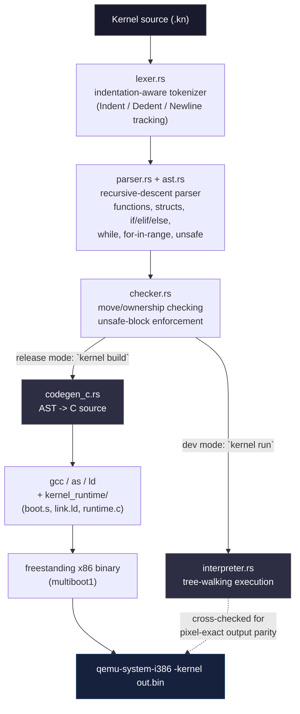

# RFC-001: End-to-end pipeline architecture — source to QEMU boot

**Status:** Implemented (v1)

## Summary

Kernel source (`.kn`) goes through six real, verified stages to become a
booting x86 binary. Every stage is independently testable; the interpreter
path and the compiled path are cross-checked against each other for
pixel-exact output agreement.

## Pipeline diagram

## Stage detail

| Stage | File | Responsibility | Verified |
|---|---|---|---|
| Lex | `src/lexer.rs` | Tokenize source, track Python-style indentation as explicit Indent/Dedent/Newline tokens (no braces in the grammar) | ✅ |
| Parse | `src/parser.rs`, `src/ast.rs` | Recursive-descent parse into an AST covering the v1 core subset | ✅ |
| Check | `src/checker.rs` | Move/ownership checking (rejects use-after-move), `unsafe`-block enforcement (rejects raw memory ops outside `unsafe`) | ✅ — both negative cases verified rejected via `examples/bad_*.kn` |
| Interpret | `src/interpreter.rs` | Tree-walking execution for `kernel run` (dev-mode, Python-speed iteration) | ✅ |
| Codegen | `src/codegen_c.rs` | Lowers checked AST to C source for `kernel build` | ✅ |
| Link/boot | `kernel_runtime/` (`boot.s`, `link.ld`, `runtime.c`) | VGA text-mode runtime + multiboot1 boot glue; `gcc`/`as`/`ld` produce a freestanding x86 binary | ✅ — boots in `qemu-system-i386`, output verified pixel-exact vs interpreter, including a `raw_write` MMIO write landing on the exact byte address specified |

## Two execution paths, one correctness bar

Kernel is unusual in that it ships **two** working executors for the same
checked AST — the tree-walking interpreter and the C-codegen-to-binary
path — and treats agreement between them as the correctness bar, not just
"the interpreter ran without crashing." This is what "boots in QEMU,
pixel-exact correct output matching the interpreter" actually means in
practice: the same `.kn` program is run both ways and the outputs are
diffed.

## Why this matters for the roadmap

Every future backend (v2 LLVM, v3 WASM, v4 native FFI) plugs into the
*same* checked AST that already feeds `codegen_c.rs` — the frontend
(lex → parse → check) doesn't change when a backend is added, only a new
lowering stage is appended. See ARD-002 for why there's no separate IR
yet.
