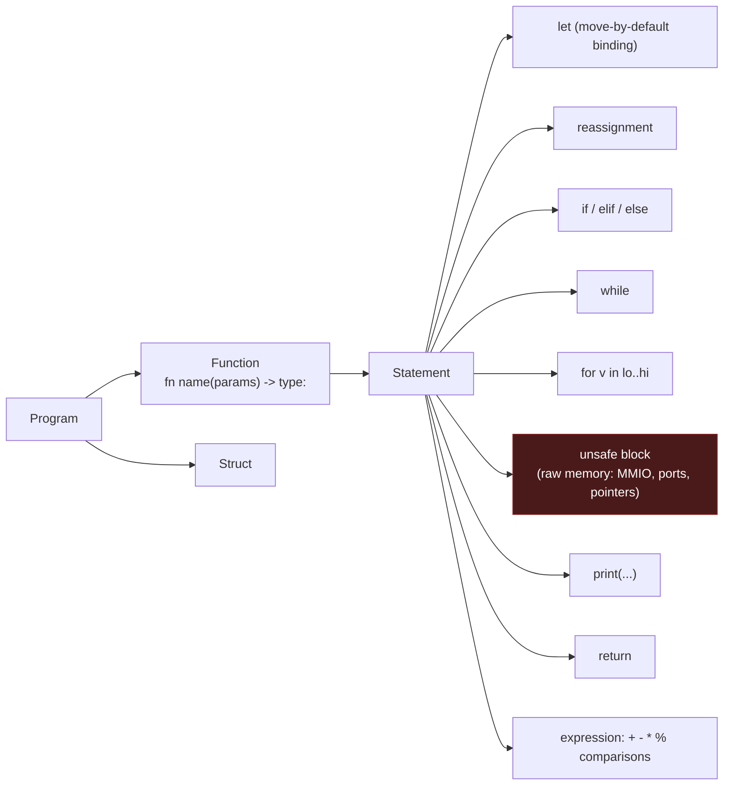

# RFC-002: Grammar & language specification (v1 subset)

**Status:** Implemented (v1 core); extended syntax spec exists but is not
yet implemented in checker/interpreter/codegen (see ARD-001)

## Summary

Kernel reads like Python (indentation-based, no braces/semicolons) but
compiles like a systems language (ownership model, `unsafe` escape hatch,
freestanding binary output). This RFC specifies exactly what v1 parses,
checks, and executes.

## Example program

```kn
fn add(a: int, b: int) -> int:
    return a + b

fn main():
    let x = 5
    let y = 10
    print(add(x, y))
```

## Grammar surface (v1 implemented)



## Ownership semantics

- Values **move by default** on assignment/pass — matches Rust's default,
  but with no lifetime annotations to write.
- `&` borrows a value without moving it.
- The checker (`checker.rs`) rejects use-after-move at compile time — see
  `examples/bad_use_after_move.kn` for the verified-rejected case.
- `unsafe { ... }` is the only way to perform raw memory access (MMIO,
  ports, raw pointers) — explicit and visually marked, never silently
  available outside the block. See `examples/bad_unsafe_outside_block.kn`
  for the verified-rejected case.

## Types (v1)

`int` is the only primitive type implemented in v1. Strings, floats, and
compound generic types are **not** implemented in the interpreter or
codegen yet, even though the broader syntax spec already anticipates
generics/traits/enums/pattern-matching/closures for corpus-generator
variety (see ARD-001). Attempting to use them is a parse/check error, not
a silent miscompile.

## v1.x additions since v1 (see ARD-001's "known, documented gap" note)

- **Generics** (`fn identity<T>(...)`, `struct Box<T>: ...`) via a
  monomorphization pass between parsing and checking (`monomorphize.rs`):
  one concrete, mangled copy generated per distinct type actually used at
  a call site. Single type parameter inferred; a second parameter in
  `fn pair<T, U>` parses but isn't substituted yet (named future work).
- **`match`** desugars entirely to `if`/`elif`/`else` at parse time (same
  "erase the feature before the checker/interpreter/codegen see it"
  approach as C-style enums below). v1.x patterns are int/bool literals
  or bare idents (enum consts) only, no destructuring/guards/or-patterns;
  string patterns are a parse error (`==` on `str` is pointer-equality in
  the C backend, a separate pre-existing gap) rather than a silent
  miscompile. Scrutinee must be a plain ident/field access (re-evaluated
  per arm, so no call-expression scrutinee).
- **Fixed-size arrays** (`[int;5]`, literals `[1, 2, 3]`, indexing
  `arr[i]`/`arr[i] = v`). No dynamic-length slices/Vec yet (a real future
  lift: fat pointer + length, heap/arena allocation). Bounds-checked at
  RUNTIME in both backends -- the interpreter panics safely (Rust-level),
  the C backend emits an inline check that halts via a new freestanding
  `kernel_panic` (see `kernel_runtime/runtime.c`) rather than reading/
  writing adjacent memory; verified end to end including in a real QEMU
  boot (`examples/arrays_test.kn`, `examples/oob_panic_demo.kn`). Move/
  borrow semantics mirror struct construction. Array function parameters
  always decay to a C pointer (arrays can't be passed by value in C) and
  array return types are rejected at codegen time with a clear error
  (wrap in a struct instead) -- both named, not silent, limitations.

## Two run modes

| Command | Path | Purpose |
|---|---|---|
| `kernel run file.kn` | interpreter.rs | Dev-mode, Python-speed iteration |
| `kernel build file.kn out.bin` | codegen_c.rs → gcc/as/ld | Optimized, freestanding compiled binary |

## Why this grammar shape

The indentation-based syntax with an explicit ownership model and a
separate `unsafe` escape hatch is the core differentiator claim: "Rust's
safety story without Rust's borrow-checker tax." The grammar is
deliberately narrow in v1 (see ARD-001) specifically so this claim can be
fully verified (lex→parse→check→interpret→codegen→boot, cross-checked)
rather than partially true across a larger surface area.
