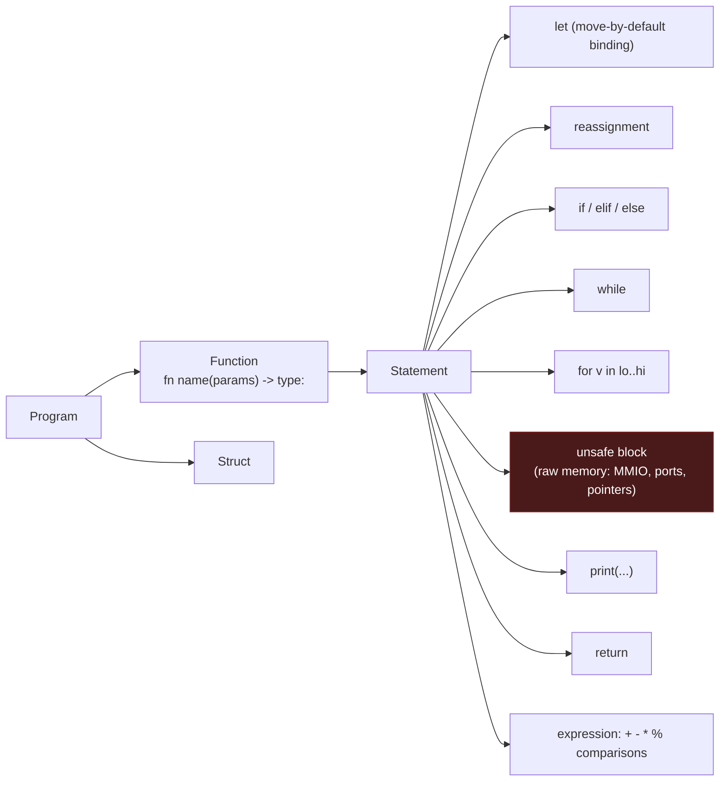

# RFC-002: Grammar & language specification (v1 subset)

**Status:** Implemented (v1 core); extended syntax spec exists but is not
yet implemented in checker/interpreter/codegen (see ARD-001)

## Summary

Kernel reads like Python (indentation-based, no braces/semicolons) but
compiles like a systems language (ownership model, `unsafe` escape hatch,
freestanding binary output). This RFC specifies exactly what v1 parses,
checks, and executes.

## Example program

```kn
fn add(a: int, b: int) -> int:
    return a + b

fn main():
    let x = 5
    let y = 10
    print(add(x, y))
```

## Grammar surface (v1 implemented)



## Ownership semantics

- Values **move by default** on assignment/pass — matches Rust's default,
  but with no lifetime annotations to write.
- `&` borrows a value without moving it.
- The checker (`checker.rs`) rejects use-after-move at compile time — see
  `examples/bad_use_after_move.kn` for the verified-rejected case.
- `unsafe { ... }` is the only way to perform raw memory access (MMIO,
  ports, raw pointers) — explicit and visually marked, never silently
  available outside the block. See `examples/bad_unsafe_outside_block.kn`
  for the verified-rejected case.
- **Immutability by default is enforced, not just parsed.** `let x = 5`
  (no `mut`) followed by `x = 10`, `x.field = 10`, `arr[0] = 10`, or
  `vec_push(&mut x, ...)` is a real checker error naming the exact
  variable — a real, previously-real gap closed in a later audit pass:
  `Stmt::Let`'s `mutable` AST field had existed since the statement was
  first written, but nothing ever actually READ it (confirmed by a real
  `cargo build` dead-code warning: "field `mutable` is never read" —
  the compiler was quite literally telling us this the whole time).
  Covers module-level `static`/`const` globals too (a `static` without
  `mut`, or any `const`, can never be reassigned) via a parallel
  `global_mutable` map. See `examples/bad_assign_immutable.kn`,
  `bad_assign_immutable_static.kn`, `bad_assign_const.kn`,
  `bad_field_assign_immutable.kn`, `bad_index_assign_immutable.kn`, and
  `bad_vec_push_immutable.kn` for the verified-rejected cases.
- **A real, now-fixed cross-backend disagreement**, found during the same
  audit: `interpreter.rs`'s `set_var` never actually wrote through to
  `self.globals` -- it silently created a brand-new LOCAL shadow binding
  instead, so a `static mut COUNTER` mutated inside a function (e.g.
  `COUNTER += 1`) never actually persisted back to the real global. Each
  separate call to that function started fresh from the global's
  ORIGINAL value. Concretely: calling the same `bump()` three times in a
  row printed `1, 1, 1` on `kernel run` while `kernel build` and `kernel
  build-native` both correctly printed `1, 2, 3` (both resolve a
  `static` identifier to one real, persistent memory location at
  compile time, so neither ever had this bug) — exactly the kind of
  silent interpreter/compiled-backend divergence this project's
  regression discipline exists to catch, caught here by deliberately
  auditing for it rather than by accident. Fixed by having `set_var`
  fall back to a real `self.globals` write when `name` isn't any
  currently-live local, before ever falling back to "new local
  binding" (verified every current call site of `set_var` only ever
  targets a name that's already either a local or a global -- `let` is
  the only thing that introduces a genuinely NEW binding, and it never
  goes through `set_var` at all). See `examples/global_persist_test.kn`.
- **Real (partial) Non-Lexical-Lifetime borrow release**: a persistent
  (`let`-bound) borrow is now released right after its REAL last
  reference within its own block, rather than always waiting for the
  block to end regardless of whether it's ever used again -- see
  `checker.rs`'s `check_block` for the full design (and its honest
  "deliberately partial" scope: a reference nested inside an `if`/
  `while`/`for` body only shortens the borrow to the end of that WHOLE
  containing statement, never to a point inside one specific branch --
  genuinely full path-sensitive NLL remains future work). Matches real
  Rust's NLL behavior for the classic "entirely unused borrow" case too:
  `let r = &x; move_it(x);` with `r` never referenced again is now
  correctly ACCEPTED (its live range is empty), where the old purely
  lexical scoping incorrectly rejected it. See
  `examples/nll_release_after_last_use_ok.kn` and
  `examples/nll_unused_borrow_ok.kn` for the two newly-accepted
  patterns, and the updated `examples/bad_move_while_borrowed.kn` (a
  borrow that's GENUINELY still live -- referenced again after the move
  attempt -- is still correctly rejected).
- Implementing this surfaced and fixed THREE further real, previously-
  undiscovered bugs, none of them actually about NLL itself -- each one
  had simply never been reachable before, since the old, stricter
  lexical scoping always rejected any program that would have exercised
  them:
  1. **A real regression from the immutability work above**: mutating
     THROUGH a `&mut` reference (`let r = &mut p; r.x = 5;`) was
     incorrectly rejected with "cannot mutate `r` -- it was declared
     with `let`, not `let mut`" -- conflating "is `r`'s own BINDING
     reassignable" with "is the REFERENT mutable through this
     reference," two different things. Fixed with a new
     `VarState::ref_exclusive` field and a `check_mutable_through`
     helper: a reference's own exclusivity governs mutation through it,
     never the reassignability of the binding holding it. Also correctly
     rejects the real unsound case this enables checking for the first
     time: mutating through a merely SHARED (`&T`) borrow. See
     `examples/bad_mutate_through_shared_borrow.kn`.
  2. **A real, deep interpreter bug**: `kernel run` never modeled
     aliasing at the value level AT ALL (`&x` just evaluates `x`,
     producing an independent clone with no memory of where it came
     from) -- so mutating through a borrowed reference silently mutated
     only the reference's own disconnected copy, never the original.
     Caught for real: `let r = &mut p; r.x = 99; print(p.x)` printed the
     ORIGINAL value, not `99`, while `kernel build`/`kernel build-native`
     (both have real addresses) mutated `p` correctly. Fixed with a new
     `ref_aliases` side-table (parallel to `scopes`) resolving a
     reference's name back to what it aliases before `FieldAssign`/
     `IndexAssign`/`vec_push`/`vec_set` mutate -- scoped to one level of
     direct `let NAME = &TARGET` aliasing; borrowed FUNCTION PARAMETERS
     aliasing back to the caller's variable remain a separate, narrower,
     still-real gap, not fixed here.
  3. **A real, deep LLVM-native-backend bug**: `codegen_llvm.rs`'s
     `struct_base_ptr`/`array_base_ptr` only checked `is_ptr` (which
     tracks FUNCTION PARAMETERS only) to decide whether to dereference a
     variable's own alloca before treating it as a struct/array's base
     address -- missing a LOCALLY `let`-bound borrow entirely (never
     tracked in `is_ptr` at all), reading one level of indirection too
     shallow and producing a garbage pointer bit-pattern. Unreachable
     before this NLL work, since the checker never previously accepted
     a program combining a local borrow with anything that would expose
     it this way. Fixed with the exact same `kernel_ty.starts_with('&')`
     check `gen_expr`'s `Expr::Ident` case already used for an earlier,
     related bug -- these two accessors just hadn't gotten it yet. See
     RFC-003 for the native-backend-specific detail.

## Types (v1)

`int` is the only primitive type implemented in v1. Strings, floats, and
compound generic types are **not** implemented in the interpreter or
codegen yet, even though the broader syntax spec already anticipates
generics/traits/enums/pattern-matching/closures for corpus-generator
variety (see ARD-001). Attempting to use them is a parse/check error, not
a silent miscompile.

## v1.x additions since v1 (see ARD-001's "known, documented gap" note)

- **Generics** (`fn identity<T>(...)`, `struct Box<T>: ...`) via a
  monomorphization pass between parsing and checking (`monomorphize.rs`):
  one concrete, mangled copy generated per distinct type actually used at
  a call site. Single type parameter inferred; a second parameter in
  `fn pair<T, U>` parses but isn't substituted yet (named future work).
- **`match`** desugars entirely to `if`/`elif`/`else`/`let` at parse time
  (same "erase the feature before the checker/interpreter/codegen see it"
  approach as C-style enums below, extended for tagged-union variant
  patterns -- see the new "Tagged-union enums" entry below for the
  `Circle(r)`-style pattern, which still desugars entirely at parse
  time, just via 3 new small `Expr` nodes (`EnumTag`/`EnumVariantTag`/
  `EnumField`) instead of a bare `==` comparison). v1.x plain-value
  patterns are int/bool literals or bare idents (old-style flat enum
  consts) only, no struct/array destructuring/guards/or-patterns;
  string patterns are a parse error (`==` on `str` is pointer-equality in
  the C backend, a separate pre-existing gap) rather than a silent
  miscompile. Scrutinee must be a plain ident/field access (re-evaluated
  per arm, so no call-expression scrutinee).
- **Tagged-union enums** (`enum Shape: Circle(int) / Square(int) /
  Rect(int, int)`), a REAL runtime type (not erased, same treatment
  `Vec<T>` got) -- construction is always call syntax (`Circle(5)`,
  `Empty()` even for a zero-field variant, see EnumDecl's doc comment in
  ast.rs for why), and `match` patterns bind fields positionally
  (`Circle(r):`, `_` to skip a binding). If EVERY variant of an `enum`
  has zero fields, it's still handled by the OLD, unchanged flat-int-
  const desugar (`examples/enums.kn`/`match_test.kn` keep working
  byte-for-byte identically) -- this is purely additive. Honest v1.x
  scope: payload fields are primitives only (int/float/str/bool, no
  struct/array/Vec/nested-enum payloads -- every backend's fixed-width
  tagged-union layout depends on this); variant names must be globally
  unique across the whole program (no `::` paths to disambiguate);
  move-by-default (non-Copy), exactly like structs; no exhaustiveness
  checking. Real, verified support on all THREE backends (interpreter,
  C/QEMU via a real C `union`, LLVM native via raw i64-slot storage with
  no cast needed thanks to opaque pointers) -- see RFC-003 for the
  native-backend layout detail. Verified end to end including a real
  QEMU boot (`examples/enum_tagged_union_test.kn`).
- **Fixed-size arrays** (`[int;5]`, literals `[1, 2, 3]`, indexing
  `arr[i]`/`arr[i] = v`). No dynamic-length slices/Vec yet (a real future
  lift: fat pointer + length, heap/arena allocation). Bounds-checked at
  RUNTIME in both backends -- the interpreter panics safely (Rust-level),
  the C backend emits an inline check that halts via a new freestanding
  `kernel_panic` (see `kernel_runtime/runtime.c`) rather than reading/
  writing adjacent memory; verified end to end including in a real QEMU
  boot (`examples/arrays_test.kn`, `examples/oob_panic_demo.kn`). Move/
  borrow semantics mirror struct construction. Array function parameters
  always decay to a C pointer (arrays can't be passed by value in C) and
  array return types are rejected at codegen time with a clear error
  (wrap in a struct instead) -- both named, not silent, limitations.
- **Basic closures** (`let f = |x: int| -> int:` + an indented block),
  via LAMBDA LIFTING (`lambda_lift.rs`), not a runtime closure value --
  there's no fat-pointer/env-struct machinery at all. Every closure is
  converted into a real top-level function (captured free variables
  become extra leading parameters) and every call site is rewritten to
  pass them explicitly, before the checker/interpreter/codegen ever run.
  v1.x scope: NON-ESCAPING only (a closure can be called by name within
  its own defining function, never passed as a value, returned, or
  stored -- a loud lift-time error otherwise) and captures PRIMITIVE free
  variables only (int/float/str/bool) -- capturing a struct or array is
  also a loud lift-time error, not silent. No recursive closures.
  Verified end to end including a real QEMU boot
  (`examples/closures_test.kn`).
- **`len(x)`** -- works on both arrays (compiles to a literal constant,
  the size is already known from the type, zero runtime cost) and
  strings (byte length via a new `kernel_strlen` runtime helper, matching
  Rust's `str::len()` exactly -- no Unicode-codepoint awareness in either
  backend). Deliberately exempted from the checker's general move-
  tracking for call arguments -- `len(my_array)` only reads the array to
  report its size, it was never meant to consume ownership the way
  passing a non-Copy value to an ordinary function does.
- **File I/O** (`read_file(path) -> str`, `write_file(path, content)`) --
  INTERPRETER-ONLY, dev-mode convenience. There is no filesystem at all
  in the C backend's target (a freestanding kernel booting under
  QEMU/real hardware), so `kernel build` rejects both with a clear error
  naming the real reason, rather than silently emitting a call to an
  undefined function that would only surface as a confusing linker error.
  (The LLVM native backend DOES support real file I/O, since its target
  -- a normal host-OS process -- genuinely has a filesystem; see
  RFC-003.)
- **`Vec<T>`** (`vec_new()`, `vec_push`, `vec_get`, `vec_len`,
  `vec_set`) -- a growable collection, unlike `[T;N]`'s fixed
  compile-time size. Real support on TWO of the three backends:
  interpreter (see above) AND the LLVM native backend (real
  `realloc`-backed growth -- doubling capacity, starting at 4 -- see
  RFC-003 for the full design, including how a real `TargetData` ABI-
  size query lets `Vec<T>` work for ANY element type -- structs, fixed-
  size arrays, even nested `Vec<Vec<int>>` -- not just primitives). The
  C/freestanding backend explicitly rejects it (no heap allocator in a
  freestanding kernel -- the exact reverse of the file-I/O asymmetry:
  THERE the C backend's target lacks a filesystem; HERE it lacks a
  heap). `let v: Vec<int> = vec_new()` requires the explicit
  `: Vec<int>` annotation because, unlike every other generic in this
  language, there's no call-site ARGUMENT to infer the element type from
  (`vec_new()` takes none) -- monomorphize.rs's usual
  infer-from-arguments strategy doesn't apply here. Mutation
  (`vec_push`/`vec_set`) in the interpreter is modeled the same way
  `Stmt::IndexAssign` already mutates an array: read the named
  variable's current value, clone+mutate, write back under the same
  name; in the LLVM native backend it's REAL mutation through the
  variable's actual stack address (no clone-and-write-back trick needed,
  since that backend has real pointers). The checker correspondingly
  treats all five `vec_*` builtins as never "moving" their Vec argument
  (same exemption `len()` gets), so the variable stays usable across
  repeated `vec_push` calls. Adding this surfaced and fixed TWO real,
  previously-latent parser bugs: `parse_type()` had never actually
  supported `Name<Arg>` type annotations at all (it broke out of its
  loop right after the first identifier, before ever checking for a
  following `<`), and its array-type branch (`[ElemType;N]`) broke
  unconditionally even when NESTED inside a still-open generic (e.g.
  `Vec<[int;3]>`), leaving the closing `>` unconsumed -- the exact same
  bug shape, just in a second place. Nothing in the existing example
  suite had ever written either, since every other generic in the
  language is inferred from call-site arguments instead.
- **A module/import system now exists**: `import foo` / `import utils.math`
  (see `modules.rs`). v1.x scope: unqualified textual splice (no
  qualified names, no pub/private visibility -- every imported item
  becomes a plain top-level name, exactly as if pasted in), resolved
  relative to the IMPORTING file's own directory, cycle/duplicate-import
  safe (like a C header guard), with a loud error on a genuine name
  collision across files (checker.rs/interpreter.rs/codegen_c.rs all
  build their tables via plain `HashMap::insert`, which would otherwise
  silently let a later definition overwrite an earlier one). Runs as the
  very first pass, before monomorphize/lambda_lift, so a generic function
  or closure defined in an imported file is handled identically to one in
  the entry file. The LSP (`kernel lsp`) resolves imports too, relative
  to the open document's own path.
- **A package manifest skeleton**: `kernel.toml` (flat `key = "value"`
  lines, NOT full TOML -- no sections/nesting, hand-parsed, no
  dependency) naming a project and its `entry` file; `kernel init`
  scaffolds one. `kernel run`/`kernel build` read it when no explicit
  path is given. Deliberately named a SKELETON: no registry, no remote
  dependencies, no version resolution -- it only establishes the two
  integration points (a manifest file, and commands that read it) a real
  future package manager would build on, now that the module system
  above gives a project something to actually span multiple files for.

## Two run modes

| Command | Path | Purpose |
|---|---|---|
| `kernel run file.kn` | interpreter.rs | Dev-mode, Python-speed iteration |
| `kernel build file.kn out.bin` | codegen_c.rs → gcc/as/ld | Optimized, freestanding compiled binary |
| `kernel lsp` | lsp.rs | Language server (JSON-RPC over stdio) -- real IDE diagnostics |
| `kernel init [name]` | manifest.rs | Scaffolds `kernel.toml` + `main.kn` for a new project |

## Developer experience: a real LSP server (Option C, v1.x)

`kernel lsp` runs the EXACT SAME pipeline as `kernel run`/`kernel build`
(lex → parse → monomorphize → lambda_lift → check) against whatever's open
in the editor and reports `textDocument/publishDiagnostics` -- a reported
diagnostic means the same program would really fail to run/build, never a
separate "IDE-only" analysis that could drift from what the compiler
actually enforces. Hand-rolled JSON-RPC/JSON (`json.rs`), no external
crates, matching ARD-006's identity.

Honest v1.x scope:
- Diagnostics only -- no hover, go-to-definition, completion, or
  formatting yet.
- Full-document sync (`textDocumentSync: 1`): the whole file is
  re-analyzed on every change notification, not incremental.
- LEX/PARSE errors get a REAL `(line, column)`, via new position tracking
  added to the lexer/parser specifically for this (every token now
  carries its source position; previously there was none at all).
  CHECKER errors have no span yet -- the AST itself carries no position
  info, only tokens do -- so those are reported at `(1, 1)` of the file,
  a real precision gap pointing at a future "give the AST spans too" lift,
  not a silently-pretended-accurate position.
- The whole pipeline is panic-based error handling except the checker;
  `kernel lsp` wraps every analysis in `catch_unwind` so a malformed
  program reports a diagnostic instead of ever crashing the server
  process -- verified against both a syntax error and a checker error in
  a real stdio JSON-RPC session (see `tests/test_lsp.py`).

### Real editor integration: `editors/vscode/`

Because `kernel lsp` is a real, standard LSP server (JSON-RPC over
stdio), ANY LSP-capable editor can use it -- Neovim, Helix, Sublime,
Emacs just need a few lines of client config pointing at the binary. A
packaged VS Code extension lives at `editors/vscode/` (syntax
highlighting via a TextMate grammar matching the real keyword table in
`lexer.rs`, plus the LSP client wiring) -- see its own README for setup.
Verified it packages into a real, valid, installable `.vsix` (confirmed
via `file`/`unzip -l`, with `vscode-languageclient` and its transitive
deps correctly bundled, not just referenced), AND verified the actual
wire protocol against a real npm LSP transport library (`vscode-
jsonrpc`, not just a hand-rolled test script) spawning the real `kernel
lsp` binary: `initialize` returns the right capabilities, a valid
program gets zero diagnostics, an invalid one gets a real diagnostic
with the real message and position.

## Why this grammar shape

The indentation-based syntax with an explicit ownership model and a
separate `unsafe` escape hatch is the core differentiator claim: "Rust's
safety story without Rust's borrow-checker tax." The grammar is
deliberately narrow in v1 (see ARD-001) specifically so this claim can be
fully verified (lex→parse→check→interpret→codegen→boot, cross-checked)
rather than partially true across a larger surface area.
