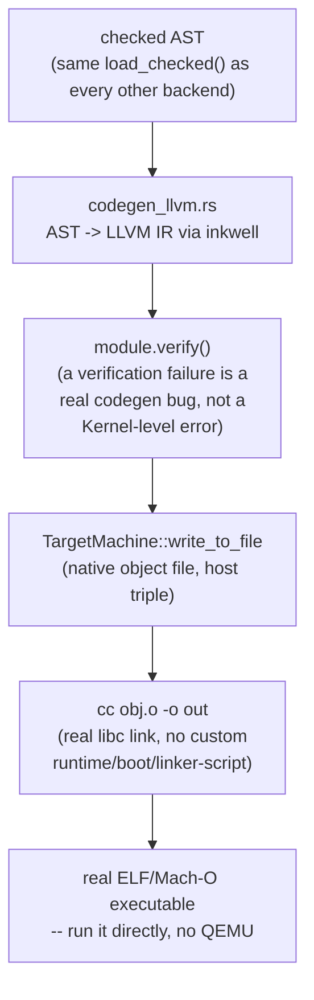

# RFC-003: native LLVM backend — a real second target, not a second kernel

**Status:** Implemented (v2 -- arrays, string concatenation, and `len()` added in a second slice)

## Summary

`kernel build-native` lowers the checked AST straight to LLVM IR (via
`inkwell`, this project's first external dependency -- see Cargo.toml's
comment and ARD-004) and emits a real native executable for the host OS,
linked against its real libc. This is NOT another way to build a
freestanding kernel image (that's `kernel build` / `codegen_c.rs`,
unchanged) -- it's the "backend/server" half of the original roadmap, a
genuinely different target: a normal `main()`, real `printf`, no VGA
text-mode hand-rolling, no `-ffreestanding`, no QEMU needed to run it at
all.

## Why LLVM gets to be the one dependency

Every other stage in this project is hand-rolled on purpose (lexer,
parser, checker, interpreter, C codegen, even the LSP's JSON encoding --
see ARD-004). LLVM is different: its actual reason to exist is a mature,
decades-deep instruction-selection/register-allocation/optimization
pipeline. Hand-rolling that would be reinventing a real compiler
backend's core, not "proving the pipeline" the way the rest of this
project does. `inkwell` is a thin, safe wrapper over `llvm-sys`; LLVM 18
itself (via `llvm-18-dev`, `libpolly-18-dev`, `libzstd-dev` on
Debian/Ubuntu) is the actual dependency.

## Honest v1.x scope

Supported, verified end to end (byte-for-byte output parity against the
interpreter, confirmed across the full example suite -- 17/20 existing
examples run unchanged, the rest are the named gaps below):

- Functions (including recursion, forward calls -- two-pass declare/
  define, same reasoning as `codegen_c.rs`), `if`/`elif`/`else`, `while`,
  `for`-in-range, `return`.
- `int`/`float`/`bool`/`str` (string literals, printing, passing as
  args, and REAL concatenation -- `+`/`+=` -- via libc `malloc`/
  `strcpy`/`strcat`, see "strings" below), structs (construction, field
  read/write, by-value params and returns, nested field access).
- Fixed-size arrays (`[T;N]`): literals, indexing (read/write, runtime-
  bounds-checked), struct fields, and function params (ALWAYS decay to
  a pointer, matching `codegen_c.rs`/C exactly). An out-of-range index
  calls real libc `puts`+`exit(1)` -- the native twin of
  `kernel_runtime/runtime.c`'s `kernel_panic` halt, just via a real OS
  process exit instead of a freestanding halt loop. Returning an array
  BY VALUE is still rejected, same reason `codegen_c.rs` rejects it too.
- Borrows (`&T`/`&mut T`) -- same scope as `codegen_c.rs`: field access
  through a borrowed PARAMETER works; field access through a locally
  `let`-bound borrow does not (an accepted limit carried over, not a new
  one -- see codegen_llvm.rs's FnCtx::is_ptr doc comment).
- `print` (real libc `printf`, one dynamically-built format string per
  call site), `abs` (manual `select`-based implementation, no libm
  dependency), and `len()` (a compile-time constant for arrays, real
  libc `strlen` for strings).
- `read_file`/`write_file`: REAL file I/O via libc stdio (`fopen`/
  `fseek`/`ftell`/`rewind`/`fread`/`fwrite`/`fclose`) -- a genuine
  backend-specific CAPABILITY DIFFERENCE from `codegen_c.rs`, not a
  cross-backend disagreement: the C backend's freestanding kernel
  target has no filesystem at all (so it still rejects both outright),
  while this backend targets a normal OS process that does. A failed
  `fopen` is a clear panic, never a silent NULL dereference.
- Top-level `static`/`const` (including desugared enum variants) as real
  LLVM globals.
- REAL short-circuit `&&`/`||` (actual branching + a phi, not a simple
  bitwise and/or) -- deliberately not simpler-than-necessary here, since
  C's `&&`/`||` (what `codegen_c.rs` emits) really does short-circuit,
  and two backends silently disagreeing on an operator's semantics is
  exactly what this project's "backends must agree" discipline exists to
  catch before it ships.

### Strings: a real design choice, not a smaller version of the C backend's

`codegen_c.rs`'s `kernel_strcat` writes into a FIXED-SIZE rotating pool
of static buffers (bounded length, bounded number of "alive" results at
once) because a -ffreestanding kernel has no malloc/heap at all. This
backend targets a normal OS process with a real heap, so `gen_concat`
uses real `malloc`/`strcpy`/`strcat` instead: correct for any length, no
truncation, no "an older still-live result gets silently overwritten"
risk the rotating pool has. The real tradeoff the other direction:
nothing allocated this way is ever freed (no GC/arena exists in v1.x of
EITHER backend) -- a named memory-leak gap, not a silent one, and a
strictly fair trade for a proof-of-concept compiler, not a production
one.

NOT yet supported -- every one of these is REJECTED with a clear, named
error at codegen time (never a silent miscompile or a confusing linker
error), same "fail loud" convention as every other gap in this project:

- `unsafe`/`raw_write` (MMIO) -- meaningless on a normal userspace
  process; `kernel build` (the freestanding C backend) is the right tool.
- Cross-compilation -- this always targets the HOST's own triple.

## Two real native-codegen bugs caught by cross-backend verification

Building `examples/multi_shared_borrow_ok.kn` surfaced two genuine bugs,
both found specifically BECAUSE output was compared against the
interpreter rather than just "did it compile":

1. Loading a locally `let`-bound borrow (`let r1 = &origin`) used the
   WRONG LLVM type for the load (the pointee's struct type instead of
   `ptr`), silently reading the wrong number of bytes from the wrong
   place -- printed a garbage pointer bit-pattern instead of `5`.
2. Passing that same borrow onward as a call argument (`peek(r1)`) took
   the ADDRESS OF `r1`'s own storage slot instead of `r1`'s VALUE (which
   is already the correct pointer) -- the classic "value vs. place"
   confusion. Fixed by always using `gen_expr` (never `gen_addr`) for
   call arguments, matching `codegen_c.rs`'s `call_arg`, which never
   special-cased borrowed parameters either -- the argument EXPRESSION
   already produces the right value on its own.

Both are now covered by `examples/multi_shared_borrow_ok.kn` (pre-
existing) and `examples/llvm_native_test.kn` (new -- struct-returning
functions, global const/static, short-circuit booleans).

## Verified

- `kernel build-native examples/hello.kn /tmp/hello_native` -> a real
  ELF executable (`file` confirms: dynamically linked, not stripped),
  run DIRECTLY with no QEMU, exit code 0, stdout `15` -- matching the
  interpreter exactly.
- Full example suite swept through `build-native`: 17 pass with exact
  interpreter-parity output (including `examples/arrays_test.kn`,
  `examples/string_concat.kn`, and `examples/oob_panic_demo.kn` --
  verified pixel-for-pixel equivalent halt behavior to the interpreter's
  Rust panic, just via real libc `puts`+`exit(1)` instead), 3 fail with
  the clear, named rejections above (`raw_write`/`unsafe`,
  `read_file`/`write_file`) -- zero silent wrong output anywhere.
- `kernel build` (C/freestanding backend) and the LSP both re-verified
  unaffected after this slice too.
