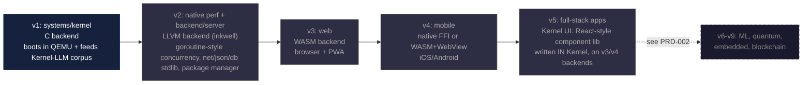

# PRD-001: Kernel (.kn)

**Status:** v1 complete and verified. v2-v5 are a dated roadmap, not
parallel work.

## Problem

Two distinct problems, solved by one project:

1. **Language design problem**: systems programming languages (C, Rust)
   either have no memory safety (C) or a real but steep learning curve to
   get it (Rust's borrow checker + lifetimes). There's room for "memory-safe
   enough to write a kernel in" without the lifetime-annotation tax, in a
   language that reads like Python.
2. **ML research substrate problem**: interpretability research questions
   like "does a transformer trained on code silently build an internal
   model of program state?" (the Othello-GPT/Chess-GPT question, applied
   to code) are hard to answer cleanly with any language a pretrained
   model has already seen — you can't rule out contamination. A language
   invented from scratch, with a hand-written (not scraped) interpreter,
   closes that gap entirely.

## Goals

- G1: A real compiler pipeline (lex → parse → check → interpret/codegen)
  that boots a toy kernel in QEMU, not a toy interpreter demo.
- G2: An ownership model that rejects real use-after-move and unsafe-escape
  violations at compile time, without lifetime annotations.
- G3: A corpus generator that can produce arbitrarily many syntactically
  valid, checker-passing programs for downstream LLM training (Kernel-LLM
  project) with zero pretraining contamination risk.

## Non-goals (v1)

- Full generics/traits/enums/pattern-matching/closures (specified in the
  grammar for future variety, not implemented — ARD-001).
- A separate Kernel IR / pluggable backend abstraction (ARD-002) — v1 has
  exactly one backend (C), built directly from the AST.
- Full flow-sensitive borrow-conflict detection (ARD-003) — move-checking
  only, per-branch, in v1.

## Target users

- **Primary**: en, personal portfolio/research project, build-in-public
  content across LinkedIn/TikTok/X/Reddit, feeds directly into the
  Kernel-LLM research project.
- **Secondary**: none planned for v1 — this is not aimed at external
  production users yet.

## Success criteria (v1 — all met)

| Criterion | Status |
|---|---|
| Lexer correctly tracks Python-style indentation | ✅ |
| Parser produces a correct AST for the full v1 grammar subset | ✅ |
| Checker rejects use-after-move (`examples/bad_use_after_move.kn`) | ✅ verified |
| Checker rejects unsafe ops outside `unsafe` (`examples/bad_unsafe_outside_block.kn`) | ✅ verified |
| Interpreter executes v1 programs correctly (dev mode) | ✅ |
| C codegen + `kernel_runtime/` produces a binary that boots in `qemu-system-i386` | ✅ |
| Interpreter output and QEMU-booted binary output are pixel-exact identical, including a `raw_write` MMIO write landing on the precise byte address specified | ✅ verified |

## Roadmap (not yet built — dated plan)

> **See [PRD-002](./PRD-002-universal-language-vision.md) for the expanded
> v2+ vision** (researched competitive pain points vs. Python/Rust/Go/
> React/Next.js/Tailwind, and new v6-v9 stages for ML, quantum computing,
> embedded/Arduino, and blockchain) and
> [ARD-005](../../architecture/ARDs/ARD-005-universal-backend-philosophy.md)
> for why this breadth doesn't fragment the language into per-domain forks.

Each stage plugs a new backend into the same frontend — not a rewrite.
v2 onward is explicitly **not** in active development; v1 is the only
shipped stage.
