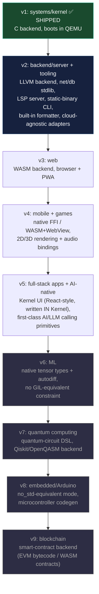

# PRD-002: Kernel's expanded vision — one coherent language that closes every major competitor's real pain points

**Status:** Vision / target state for v2 and beyond. **v1 remains scope-locked
and unchanged** (see ARD-001) — nothing here retroactively expands v1's
shipped scope. This document defines what "top-tier" means and maps it to
roadmap stages, several of which (v6-v9) are new additions this document
introduces.

## Why this document exists

The original roadmap (PRD-001) already planned systems → backend/server →
web → mobile → full-stack UI, each a new backend bolted onto the same
frontend. en's ambition is larger: Kernel should be legitimately
competitive with — not just "also able to do a bit of" — Python, Rust, Go,
and the JS/React/Next.js/Tailwind stack, while also reaching into domains
none of those fully own: ML, quantum computing, embedded/Arduino,
blockchain, and AI-native tooling, without fragmenting into a different
language per domain the way the current ecosystem does.

## Researched pain points, by competitor (cited, not assumed)

### Python
| Pain point | Evidence |
|---|---|
| GIL still limits CPU-bound concurrency in the default build; free-threaded build (PEP 703/779) exists but is opt-in, breaks extension compatibility | netguru.com, anatomyit.dev 2025 |
| Packaging fragmentation — pip/conda/poetry/venv solving the same problem differently; "most difficult of any language to get installed on a new machine" even in 2025 | Lawrence Krubner, LinkedIn 2025; `uv`/`ruff` have improved but not eliminated this |
| Mobile and browser are tier-3/niche — bundled interpreter bloats app size, native UI libraries (Kivy/BeeWare) don't look native | netguru.com citing PEP 730/738 |
| No compiled single-binary deployment story; native extensions need per-platform wheel builds | devache.com Python pain points |
| Runtime-only type errors (dynamic typing) | universally cited |

### Rust
| Pain point | Evidence |
|---|---|
| Slow incremental compilation — "the single biggest developer complaint year over year" in the 2025 State of Rust Survey | infoworld.com, techtalknews.com |
| Steep learning curve / borrow checker tax — 22% of non-users cite "too difficult to learn"; 52% of users still "learning it" | devache.com, techtalknews.com |
| Async ecosystem fragmentation — no unified runtime, tokio vs async-std, incompatible quirks | devache.com |
| No production-ready cross-platform GUI framework (egui/iced/druid all immature) | devache.com |
| High disk usage, subpar debugging experience | 2025 State of Rust Survey |

### Go
| Pain point | Evidence |
|---|---|
| Error-handling verbosity (`if err != nil` boilerplate) — "one of the oldest and most persistent complaints," topped surveys for years | go.dev/blog/error-syntax |
| No enums/sum types, limited generics | Go 2025 Developer Survey write-ins |
| Idiom uncertainty even among experienced users (33% top frustration) | Go 2025 Developer Survey |
| Weak expressivity for complex domain modeling | shared-evidence synthesis (devache/kavach) |

### JavaScript / React
| Pain point | Evidence |
|---|---|
| `useEffect` frustrations (37%) and dependency-array footguns (21%) remain the top React complaints | State of React 2025-2026 (Strapi) |
| Server Components are polarizing — 3rd/4th most-disliked features despite 45% adoption; Context API incompatibility (59 mentions), testing gaps (24 mentions) | State of React 2025-2026 |
| No native type safety — TypeScript is a bolted-on, separate tool | universally cited |
| Tooling fragmentation ("JavaScript fatigue") — competing state management, routing, build tools | isquaredsoftware.com 2025 |

### Next.js
| Pain point | Evidence |
|---|---|
| 17% negative sentiment despite 80% usage — "excessive complexity and too-tight integration with its sponsor" (Vercel) | The Register, Feb 2026, React survey |
| Client/server boundary confusion cited as the #1 team-reported issue; one team's onboarding time went from 2 weeks to 6 | dev.to, "RSC are breaking production apps" |
| Caching behavior causes unexplainable production bugs | same source |
| Vendor lock-in perception — "Vercel is driving React development... to make more money hosting sites" | isquaredsoftware.com |

### Tailwind CSS
| Pain point | Evidence |
|---|---|
| Utility-class markup bloat — "a simple div with 15 classes is no longer a div, it's a mystery" | dev.to, "Why I No Longer Use Tailwind" |
| Breaks structure/design separation; hard to scan in devtools (no property column, just a long class string) | en.andros.dev |
| DRY violations — a design token (e.g. brand color) repeats across `bg-`, `text-`, `border-`, `ring-` variants with no single source of truth | dev.to |
| Steep "hidden" learning curve — looks simple, actually requires memorizing thousands of class names | multiple sources |

## What every one of these pain points has in common

Looking across all six: **every complaint is a consequence of a design
choice the language/framework made and never revisited** — Go skipped
sum types on purpose, Rust's safety guarantees are inherently expensive to
compile, React's server/client split is an incremental bolt-on to a
client-only design, Tailwind's "no CSS abstraction" is the literal feature
being complained about. Kernel's opening isn't "avoid all tradeoffs" (impossible)
— it's **make the tradeoffs explicit, and keep every backend sharing one
frontend so fixing a pain point in one domain doesn't require learning a
different language**.

## Requirement → design response mapping

| en's requirement | Design response | Roadmap stage |
|---|---|---|
| Infra/cloud/database/deployment agnostic | Stdlib built around portable interfaces (`net.http`, `db`, `fs`) with pluggable backend adapters per cloud/DB — write once, swap adapters, never rewrite application code | v2 |
| Works in any IDE/terminal | A real Language Server Protocol (LSP) implementation (one server, works in VS Code, Neovim, JetBrains, any LSP-compatible editor) + a single static-binary CLI (`kernel`) with no runtime dependency to install | v2 |
| Systems + mobile + web + PWA + games | Already the core v1-v4 roadmap shape; extend v4 (mobile) and add explicit game-dev support (2D/3D rendering + audio bindings) as its own named surface, not an afterthought of "mobile" | v1 (done) → v4 (extended) |
| AI-wireable | Native async primitives for calling LLM/AI services as first-class stdlib (not a bolted-on SDK) — directly informed by building Kernel AI itself (see kernel-llm's ARD-002) | v5 |
| "Advanced for this generation" | Modern PL research already guides v1's choices (ownership without lifetime tax); continue tracking modern features (pattern matching, algebraic effects) already specified in the grammar for future implementation (ARD-001) | v2+ |
| ML | Native tensor/array types + autodiff primitives in stdlib, not a bolted-on library — avoids Python's "GIL + PyTorch's Python-centric coupling limits production deployment" pain point (devache.com) by designing concurrency in from the start | v6 (new) |
| Quantum computing | A quantum-circuit DSL subset compiling to a real backend (Qiskit/OpenQASM interop) — new domain, no existing competitor solves this inside a general-purpose systems language | v7 (new) |
| Arduino / electronics | A `no_std`-equivalent minimal runtime mode (same idea as Rust's `#![no_std]`) targeting microcontroller codegen, reusing the existing C-codegen backend's freestanding-binary experience from v1's QEMU boot work | v8 (new) |
| Clean code organization | A built-in, opinionated formatter (gofmt-style: one canonical format, zero bikeshedding) + a real module system from day one, avoiding Python's "every project invents its own layout" problem | v2 |
| Frontend + backend + API services | v2 (server/API stdlib) + v3 (web/WASM frontend) + v5 (Kernel UI) already cover this; the differentiator vs. React/Next is one language end to end, no client/server boundary confusion because there's one type system across both sides | v2, v3, v5 |
| Blockchain | A smart-contract backend target (compile to EVM bytecode or a WASM-based chain-agnostic contract format) reusing the same checked-AST pipeline | v9 (new) |
| Security / cybersecurity | The ownership model (ARD-003 in kernel-lang) is already a security feature — memory-safety bugs are a huge fraction of real-world CVEs. Extend with built-in static analysis for common vulnerability classes (injection, integer overflow — already caught by debug-mode Rust-style panics per the kernel-lang README) | v1 (partial, ongoing) → v2+ |

## Expanded roadmap

Each new stage still plugs into the same checked AST established in v1 —
see ARD-005 for why this is architecturally possible without forking the
language per domain.

## Honest scope assessment

This is now, explicitly, a multi-year roadmap spanning nine major stages,
several (ML, quantum, embedded, blockchain) requiring real domain expertise
beyond compiler engineering. None of this is a near-term build commitment:

- **v1 stays exactly as shipped** — scope-locked per ARD-001, not reopened
  by this document.
- Stages v2-v5 were already planned; this document adds detail (LSP,
  formatter, cloud-agnostic adapters, explicit game-dev support,
  AI-native primitives) but doesn't change their sequencing.
- **v6-v9 are new** and each is realistically its own multi-month
  research-and-build effort once reached — quantum and blockchain backends
  especially have no shortcut; they require real domain correctness (a
  wrong quantum circuit compilation or a buggy smart-contract backend has
  real consequences).
- The honest comparison point isn't "Kernel already beats Rust/Python/
  React" — none of v2-v9 is built yet. It's "here is a researched,
  evidence-based target for what beating them would actually require,
  and a roadmap that gets there without fragmenting into N different
  languages."
